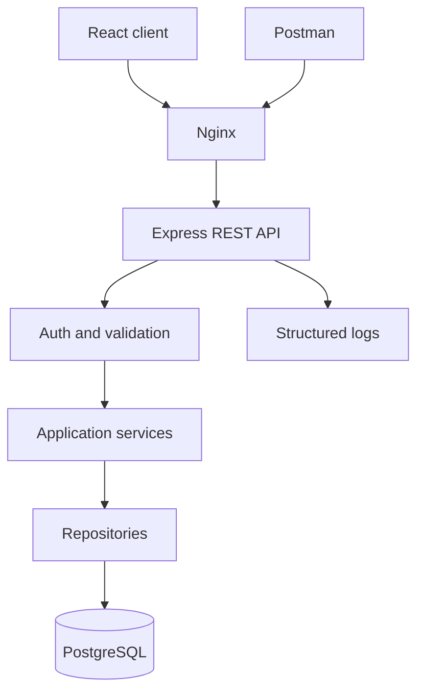
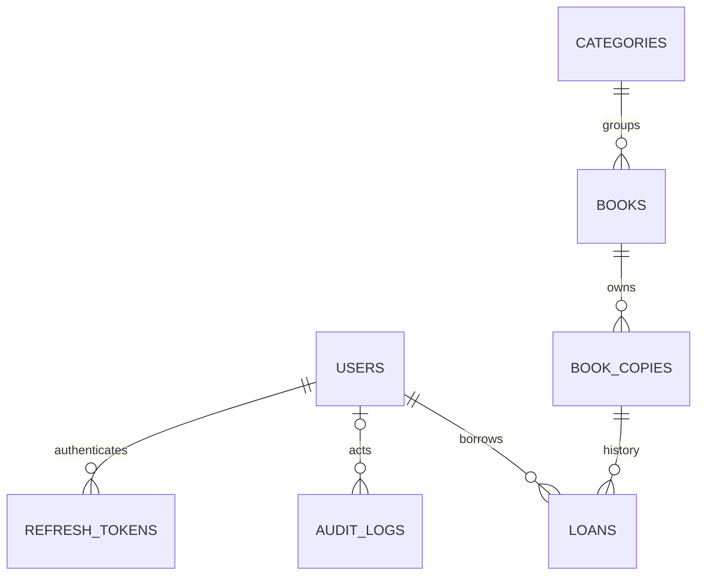
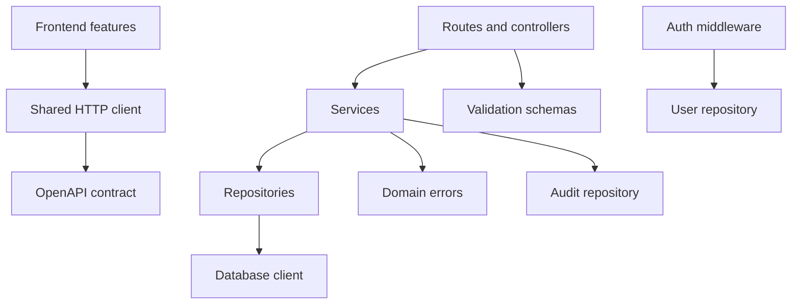

# Bản thiết kế dự án giữa kỳ RESTful Web Services

**Môn học:** Web Programming & Applications — 503073  
**Học kỳ:** 1, năm học 2026–2027  
**Đề tài số 1:** Restful Web Services  
**Sản phẩm demo đề xuất:** BookFlow — Library Management REST API and Web Application  
**Ngày lập:** 19/10/2026 · **Phiên bản:** 1.2 — đầy đủ chức năng trong 7 ngày với AI · **Trạng thái:** Thiết kế trước triển khai

| Thành viên | MSSV |
| --- | --- |
| Nguyễn Minh Quân | 52400227 |
| Phạm Văn Tú | 52400252 |
| Lê Nguyễn Vạn An | 52400258 |

Tài liệu này là bản thiết kế và kế hoạch thực hiện, chưa phải mô tả một hệ thống đã lập trình hoặc kiểm thử thành công. Yêu cầu học phần được trích từ `503073-Midterm-V1.docx`; tên sản phẩm, công nghệ, nghiệp vụ và phân công là phương án đề xuất cho nhóm ba người. Viết tiếng Việt để phối hợp nội bộ; báo cáo chính thức, slide và phần trình bày nên thống nhất tiếng Anh, trong đó đề bắt buộc báo cáo và video tiếng Anh.

## 1. Tổng quan dự án

### 1.1. Mục tiêu

Xây dựng website quản lý mượn–trả sách có frontend sử dụng REST API. Người đọc tra cứu sách và xem lịch sử mượn; thủ thư quản lý đầu sách, bản sách và xác nhận trả; quản trị viên quản lý người dùng. API có thể được sử dụng độc lập qua Postman và tài liệu OpenAPI.

Trọng tâm học thuật là giải thích REST, tài nguyên, HTTP semantics, statelessness, xác thực, phân quyền và đánh đổi thiết kế. Nghiệp vụ thư viện tạo tình huống thực tế để kiểm chứng API, thay vì chỉ trình diễn CRUD rời rạc.

### 1.2. Những yêu cầu phải bám sát đề

| Yêu cầu trong đề | Hướng đáp ứng |
| --- | --- |
| Thời gian thực hiện 8 tuần | Đề cho 8 tuần; nhóm chủ động thực hiện trong 7 ngày theo yêu cầu mới; xem phụ lục |
| Thuyết trình tuần 9–10, mỗi thành viên tham gia | Mỗi người phụ trách lý thuyết và demo phần mình; chuẩn bị slide |
| Khảo sát lịch sử, nguyên lý, đặc tả, thực hành tốt | Chương cơ sở lý thuyết, dùng tài liệu gốc và RFC |
| Phân tích ưu nhược điểm, so sánh giải pháp | So sánh REST với GraphQL và SOAP theo cùng tình huống |
| Website demo hoạt động, không quá đơn giản | JWT, RBAC, CRUD, mượn–trả, transaction, kiểm thử cạnh tranh |
| Báo cáo 20–60 trang, không tính bìa và phụ lục | Dự kiến 30–40 trang, có ERD, sequence, ảnh demo và bảng kết quả |
| Báo cáo Word và PDF theo mẫu Khoa | Cần lấy thêm `Report templates and guidelines.zip`; chưa có trong tệp đính kèm |
| Source đầy đủ, dependency file, README cài và thử | Repository, lockfile, migration, seed, OpenAPI, Postman, README |
| Video có âm thanh, tối đa 20 phút, đủ thành viên | Kịch bản khoảng 18 phút, dùng tiếng Anh |

Đề chấm báo cáo 6 điểm: hiểu lý thuyết 2; so sánh 1; ứng dụng 1; cấu trúc và trình bày 2. Demo 4 điểm: phạm vi 2; độ rõ ràng 1; video và kỹ năng trình bày 1. Thiếu video demo có âm thanh hoặc thiếu source hoàn chỉnh kèm hướng dẫn chạy có thể làm phần demo nhận 0 điểm. Đề quy định trừ 1 điểm mỗi ngày trễ, kể cả trễ một giây bị tính thành một ngày. Không được suy diễn rằng làm đủ chức năng sẽ chắc chắn đạt điểm tuyệt đối.

### 1.3. Phạm vi và ưu tiên

| Mức | Chức năng |
| --- | --- |
| P0 — bắt buộc của phương án nhóm | Đăng ký/đăng nhập; JWT; 3 vai trò; sách/thể loại/bản sách; tìm kiếm, phân trang; mượn–trả; bảo vệ dữ liệu; OpenAPI; test; README; tài liệu và video |
| P1 — hoàn thiện trong tuần sau P0 | Refresh rotation; ETag và conditional GET; chống cập nhật mất dữ liệu; dashboard; audit viewer |
| P2 — hướng phát triển sau bàn giao | Đặt trước; email nhắc hạn; upload ảnh; tìm kiếm toàn văn; OAuth/OIDC login |

JWT, HTTP methods, bảo mật và so sánh REST/GraphQL/SOAP là nội dung phù hợp gợi ý đề số 1. Refresh token, dashboard và ETag là phần nhóm tự đề xuất, không phải điều kiện riêng bắt buộc của giảng viên. Không đưa thanh toán, phạt tiền, chat, ứng dụng di động hoặc microservices vào P0.

### 1.4. Phạm vi đầy đủ trong một tuần với AI

**Thời gian thực hiện: 7 ngày. Phạm vi: giữ toàn bộ thiết kế ban đầu và đưa các phần hoàn thiện P1 vào kế hoạch tuần này.** Nhóm sử dụng AI để tăng tốc xây dựng, kiểm tra và tài liệu hóa; không thu gọn tính năng chỉ vì thời gian một tuần. P0/P1 biểu thị thứ tự triển khai, không phải phần sẽ bị loại. P2 vẫn là hướng phát triển như bản thiết kế đầu tiên, không tự mở rộng thành nghĩa vụ bàn giao.

- Hoàn thiện React/TypeScript, Express/TypeScript và PostgreSQL theo kiến trúc module; giao diện responsive, các trạng thái loading/empty/error, form validation và component dùng chung.
- Đầy đủ đăng ký/đăng nhập, JWT, ba vai trò, quản lý người dùng, ownership; thêm refresh rotation, phát hiện reuse và logout thu hồi refresh token. Tải lại trang có thể phục hồi đăng nhập qua refresh hợp lệ.
- Đầy đủ CRUD thể loại/đầu sách/bản sách, tìm kiếm, lọc, phân trang, lưu trữ và bảo toàn lịch sử.
- Đầy đủ mượn–trả, hạn mức, quá hạn, khóa hàng, rollback, chống tranh chấp bản sách cuối và tính idempotent của xác nhận trả.
- Hoàn thiện dashboard, audit viewer, ETag/conditional GET và chống cập nhật mất dữ liệu bằng If-Match cho metadata sách.
- Có OpenAPI/Swagger, Postman, unit/integration/concurrency tests và E2E tự động cho luồng chính; kiểm tra thủ công bổ sung cho giao diện.
- Có Docker Compose, Nginx, migration/seed, health checks và hướng dẫn chạy được kiểm chứng trên máy thứ hai. Hosting công khai vẫn tùy chọn như bản đầu.
- Thực hiện bài đo hiệu năng với dữ liệu và môi trường được ghi rõ; lưu kết quả thật, không thay mục tiêu bằng số liệu giả định.
- Báo cáo tiếng Anh dự kiến 30–40 trang nội dung trong giới hạn 20–60 của đề; Word/PDF theo mẫu Khoa, slide và video khoảng 18 phút, đủ ba thành viên.

AI hỗ trợ sinh skeleton, hiện thực theo OpenAPI, viết test, rà soát lỗi và soạn bản nháp tài liệu. Mỗi thành viên phải chạy, review và giải thích được phần mình phụ trách. Không coi mã do AI sinh là đã đúng hoặc test do AI viết là đã pass. Nhóm lưu bằng chứng thực nghiệm và kiểm tra lại nguồn trước khi trích dẫn. Thời gian khả dụng mỗi ngày chưa được xác nhận; lịch 7 ngày là mục tiêu tổ chức công việc, không phải bảo đảm năng suất chỉ nhờ có AI.

## 2. Tech Stack

| Lớp | Lựa chọn đề xuất | Lý do |
| --- | --- | --- |
| Frontend | React + TypeScript, Vite | Tách client/server, tạo giao diện tương tác và tái sử dụng component |
| Giao diện | CSS Modules, CSS variables | Ít phụ thuộc, dễ thống nhất màu sắc và responsive |
| Gọi API | Fetch API với một lớp HTTP client dùng chung | Thấy rõ method, header, body và status code |
| Backend | Node.js bản LTS còn được hỗ trợ + Express + TypeScript | Dễ trình bày HTTP middleware, route và tầng nghiệp vụ |
| CSDL | PostgreSQL | Khóa ngoại, unique constraint và transaction phù hợp mượn–trả |
| Truy cập dữ liệu | `pg` / node-postgres, SQL tham số hóa | Minh bạch truy vấn, khóa hàng và transaction; tránh học thêm ORM |
| Xác thực | JWT access token; Argon2id cho mật khẩu | Tách token xác thực khỏi lưu trữ mật khẩu |
| Validation | Zod | Kiểm tra dữ liệu ở ranh giới API |
| Tài liệu API | OpenAPI 3.1, Swagger UI, Postman | Hợp đồng API và demo độc lập frontend |
| Kiểm thử | Vitest, Supertest, Playwright | Unit, HTTP integration và luồng trình duyệt |
| Logging | Pino | Log JSON có cấu trúc và lọc trường nhạy cảm |
| Triển khai | Docker Compose; Nginx cho static frontend và reverse proxy | Chạy lại được trên máy giảng viên, cùng origin khi triển khai |
| Chất lượng mã | ESLint, Prettier, Git | Giảm lỗi phối hợp và giữ lịch sử đóng góp |

Không mặc định “bản mới nhất” là tương thích. Ngày 1 xác minh phiên bản Node và thư viện, chạy smoke test, chốt `.nvmrc`, `engines`, lockfile và image tag cụ thể. Đây là thiết kế lựa chọn công nghệ, chưa phải manifest đã kiểm chứng. Nếu nhóm đã bị ràng buộc dùng Java/PHP bởi yêu cầu khác, cần điều chỉnh stack trước khi viết source; tệp đề hiện tại cho phép tự chọn công nghệ.

## 3. Cấu trúc thư mục

Cấu trúc dự kiến trong một repository; danh sách dưới đây không khẳng định các tệp đã tồn tại.

```text
bookflow/
  README.md
  .env.example
  .gitignore
  .nvmrc
  compose.yaml
  client/
    package.json
    package-lock.json
    src/
      app/                 # Router, providers, layout
      features/            # auth, catalog, loans, administration
      components/          # Table, Dialog, Pagination, FormField
      lib/                 # HTTP client và error mapper
      styles/
    tests/
  server/
    package.json
    package-lock.json
    src/
      app.ts
      server.ts
      config/
      db/                  # Pool và transaction helper
      middleware/          # Auth, roles, validation, request ID
      modules/
        auth/
        users/
        categories/
        books/
        copies/
        loans/
        audit/
      shared/              # Domain errors và pagination
    migrations/
    seeds/
    tests/
  docs/
    PROJECT_BLUEPRINT.md
    openapi.yaml
    diagrams/
    evidence/
    report/
    slides/
  postman/
    BookFlow.postman_collection.json
    BookFlow.local.postman_environment.json
  deploy/
    client.Dockerfile
    server.Dockerfile
    nginx.conf
  scripts/
    migrate.ts
    seed.ts
```

Trong mỗi module backend có `*.routes.ts`, `*.controller.ts`, `*.service.ts`, `*.repository.ts`, `*.schema.ts`. Chỉ tạo file khi có trách nhiệm thực tế, tránh file rỗng và abstraction không dùng. Không commit `node_modules`, `.env`, token thật hoặc bản dump chứa dữ liệu cá nhân.

## 4. Kiến trúc hệ thống

Chọn monolith chia module, frontend tách riêng. Một backend phục vụ JSON; frontend chỉ gọi API, không kết nối database. Trình duyệt và Postman dùng cùng hợp đồng HTTP.



Controller nhận/trả HTTP. Service quyết định nghiệp vụ và transaction. Repository thực thi SQL qua client được truyền vào. Middleware xử lý xác thực, quyền sơ bộ và validation; service tiếp tục kiểm tra quyền trên tài nguyên cụ thể. Response DTO loại bỏ password hash và trường nội bộ.

REST không đồng nghĩa chỉ với JSON CRUD. Theo Fielding [R1], cần xem xét client–server, stateless, cache, uniform interface, layered system và code-on-demand tùy chọn. Demo thể hiện các ràng buộc qua tách client/API, request tự mang thông tin xác thực, cache policy, tài nguyên và HTTP semantics. Liên kết `self`, `book`, `return` có thể bổ sung; frontend vẫn biết trước các route nên phải thừa nhận mức hypermedia còn hạn chế.

## 5. Phân rã module

| Module | Trách nhiệm | Người phụ trách đề xuất | Đầu ra kiểm chứng |
| --- | --- | --- | --- |
| Auth và Users | Đăng ký/đăng nhập, JWT, vai trò, khóa tài khoản | Nguyễn Minh Quân | Endpoint, test quyền, màn hình tài khoản |
| Catalog | Thể loại, đầu sách, bản sách, tìm kiếm | Phạm Văn Tú | CRUD, repository SQL, trang catalog |
| Loans | Mượn, trả, hạn mượn, lịch sử | Lê Nguyễn Vạn An | Transaction, test cạnh tranh, trang phiếu mượn |
| Nền tảng backend | Config, error handler, logger | Quân; Tú review | App khởi động, log và error contract |
| UI dùng chung | Layout, form, bảng, responsive | Tú; An review | Component dùng chung và trạng thái lỗi/loading |
| Chất lượng và chạy demo | Test E2E, Compose, seed | An; Quân review | Chạy được từ checkout sạch |
| Báo cáo, slide, video | Mỗi người viết và nói phần mình | Cả ba | Minh chứng đóng góp và sản phẩm thống nhất |

Mỗi thành viên làm cả backend, frontend và kiểm thử của module để hiểu trọn luồng. Người phụ trách không có nghĩa làm độc quyền; mỗi pull request cần một người khác review. Nhóm thống nhất OpenAPI và schema trước khi phát triển song song.

## 6. Request Flow

Ví dụ người đọc mượn một đầu sách qua `POST /api/v1/loans`:

```mermaid
sequenceDiagram
  participant U as Client
  participant A as API
  participant S as LoanService
  participant D as PostgreSQL
  U->>A: POST loans + Bearer token + bookId
  A->>A: Verify JWT, validate body
  A->>S: createLoan(actorId, bookId)
  S->>D: BEGIN; lock borrower row
  S->>D: Check limit; lock available copy
  alt Copy available and policy satisfied
    S->>D: Insert loan and audit; COMMIT
    S-->>A: New loan
    A-->>U: 201 + Location + JSON
  else No copy or borrowing blocked
    S->>D: ROLLBACK
    S-->>A: Domain conflict
    A-->>U: 409 problem+json
  end
```

Thứ tự pipeline: request ID → giới hạn kích thước body → security headers và CORS → parse JSON → rate limit → route/auth/validation → controller → service/repository → response; mọi lỗi đi qua error handler cuối. Lỗi parse JSON cần được chuẩn hóa như các lỗi khác. Request ID xuất hiện trong response và log để đối chiếu.

## 7. Authentication

### 7.1. Nền tảng P0 trước khi tích hợp refresh P1

Người dùng đăng ký bằng tên, email và mật khẩu; server luôn gán vai trò `MEMBER`. Email được trim và chuẩn hóa chữ thường trước khi kiểm tra duy nhất. Mật khẩu chỉ lưu Argon2id hash; không log, trả về hoặc lưu plaintext.

Đăng nhập đúng trả access token JWT thời hạn đề xuất 15 phút. Claims tối thiểu: `sub`, `iss`, `aud`, `iat`, `exp`; không đưa mật khẩu, dữ liệu riêng tư hoặc quyền do client tự gửi vào token. Chỉ chấp nhận thuật toán đã cấu hình, kiểm tra chữ ký, issuer, audience và thời hạn theo hướng dẫn JWT [R4]. Dùng một signing secret ngẫu nhiên đủ mạnh cho thuật toán HMAC đã chọn; không dùng secret ví dụ trong môi trường thật.

Frontend giữ access token trong bộ nhớ; tải lại trang ở P0 cần đăng nhập lại. Gửi token qua `Authorization: Bearer ...`. Đăng xuất P0 chỉ xóa token phía client; token bị sao chép vẫn có thể tồn tại đến hết hạn. Mỗi request bảo vệ đọc lại trạng thái tài khoản và vai trò từ DB, nên khóa tài khoản hoặc hạ quyền có hiệu lực từ request tiếp theo. Đây là dữ liệu tài nguyên, không phải trạng thái phiên hội thoại lưu trong RAM server.

### 7.2. P1 hoàn thiện trong tuần

Thêm refresh token ngẫu nhiên, chỉ lưu hash trong DB; thời hạn đề xuất 7 ngày. Trình duyệt nhận cookie `HttpOnly`, `Secure` ở HTTPS, `SameSite=Strict`, giới hạn Path theo nhóm endpoint auth. Refresh rotation thực hiện nguyên tử: vô hiệu token cũ, tạo token mới; phát hiện dùng lại token thì thu hồi token family. Frontend chỉ cho một refresh request tại một thời điểm để tránh tự gây reuse.

Refresh/logout dựa trên cookie phải kiểm tra Origin và cơ chế chống CSRF. Logout thu hồi refresh token, xóa cookie với đúng path; access token còn hiệu lực đến hết hạn nếu không có cơ chế thu hồi riêng. Không mô tả refresh-token store là hệ thống hoàn toàn không lưu trạng thái xác thực. OAuth là khung ủy quyền; JWT là định dạng token. OAuth/OIDC được khảo sát trong báo cáo, chưa tích hợp P0.

## 8. Authorization

| Thao tác | Khách | MEMBER | LIBRARIAN | ADMIN |
| --- | --- | --- | --- | --- |
| Xem/tìm sách đang hoạt động | Có | Có | Có | Có |
| Xem sách lưu trữ | Không | Không | Có | Có |
| Mượn sách cho chính mình | Không | Có | Không | Không |
| Xem phiếu của chính mình | Không | Có | Không áp dụng | Không áp dụng |
| Xem mọi phiếu, xác nhận trả | Không | Không | Có | Có |
| Quản lý sách/thể loại/bản sách | Không | Không | Có | Có |
| Quản lý vai trò/trạng thái tài khoản | Không | Không | Không | Có |
| Xem audit log | Không | Không | Không | Có |

Ba vai trò loại trừ nhau trong bản đầu; không mặc định ADMIN được mọi hành vi của MEMBER. Có thể mở rộng đa vai trò sau. MEMBER không truyền `userId` để mượn thay người khác; service lấy ID từ principal đã xác minh. Với phiếu không thuộc quyền xem, trả 404 để tránh xác nhận sự tồn tại của dữ liệu người khác. Chỉ kiểm tra menu frontend là không đủ.

Không cho tự thay role qua đăng ký hoặc sửa hồ sơ. Không khóa/hạ quyền admin hoạt động cuối cùng; kiểm tra trong transaction có khóa để hai admin không đồng thời vô hiệu hóa nhau. Không dùng MSSV làm mật khẩu. Tài khoản demo dùng dữ liệu tổng hợp.

## 9. Database

### 9.1. Mô hình dữ liệu

| Bảng | Trường chính dự kiến | Ràng buộc và ý nghĩa |
| --- | --- | --- |
| users | id UUID, full_name, email, password_hash, role, status, created_at | Email normalized UNIQUE; role MEMBER/LIBRARIAN/ADMIN; status ACTIVE/DISABLED |
| categories | id UUID, name, slug, created_at | name/slug UNIQUE theo quy tắc chuẩn hóa |
| books | id UUID, category_id, isbn, title, author, description, archived_at, version | FK categories RESTRICT; isbn UNIQUE khi có; version tăng mỗi cập nhật |
| book_copies | id UUID, book_id, barcode, condition_status, created_at | FK books RESTRICT; barcode UNIQUE; condition AVAILABLE/MAINTENANCE/RETIRED |
| loans | id UUID, user_id, copy_id, borrowed_at, due_at, returned_at, returned_by | FK users và copies RESTRICT; returned_by nullable FK users |
| audit_logs | id UUID, actor_id, action, entity_type, entity_id, request_id, occurred_at | Không lưu token/password; actor nullable cho tác vụ hệ thống |
| refresh_tokens (P1) | id, user_id, token_hash, family_id, expires_at, revoked_at, replaced_by | Hash UNIQUE; phục vụ rotation và thu hồi |

Một đầu sách có nhiều bản sách vật lý; một phiếu chỉ mượn một bản. Không có bảng authors và quan hệ nhiều tác giả ở P0; `author` là chuỗi hiển thị. `condition_status=AVAILABLE` chỉ nói bản sách có thể phục vụ, chưa đủ kết luận đang rảnh: phải không có loan chưa trả.



ERD rút gọn; quan hệ người xác nhận trả được mô tả ở bảng trường. `REFRESH_TOKENS` chỉ có khi triển khai P1.

### 9.2. Tính nhất quán

Tạo partial unique index trên `loans(copy_id) WHERE returned_at IS NULL` để một bản sách không có hai phiếu đang mở. Thêm CHECK `due_at > borrowed_at` và `returned_at IS NULL OR returned_at >= borrowed_at`; yêu cầu `returned_at` và `returned_by` cùng có hoặc cùng không có giá trị đối với luồng trả có nhân viên xác nhận.

Trạng thái quá hạn được tính từ `returned_at IS NULL AND due_at < now()`; không lưu cờ quá hạn có nguy cơ lỗi thời. Dùng `timestamptz`, lưu và trao đổi ISO 8601 UTC, hiển thị Asia/Ho_Chi_Minh. Không lưu `available_count` ở P0: tính từ bản sách đủ điều kiện và phiếu đang mở.

Index đề xuất: `books(category_id)`, `book_copies(book_id, condition_status)`, `loans(user_id, returned_at)`, partial index `loans(due_at) WHERE returned_at IS NULL`. Tìm `ILIKE '%keyword%'` trên dữ liệu nhỏ chấp nhận scan; không khẳng định B-tree thường tối ưu được tìm chuỗi con. Chỉ thêm trigram/full-text khi có số đo.

Xóa đầu sách là lưu trữ bằng `archived_at`, chặn nếu còn phiếu mở; lịch sử vẫn tham chiếu được. Xóa thể loại chỉ được khi không còn đầu sách tham chiếu. Bản sách đã có lịch sử chỉ chuyển RETIRED; không xóa lịch sử mượn. Migration chỉ chạy một lần theo version, seed có thể chạy lại mà không nhân đôi dữ liệu.

## 10. API Architecture

### 10.1. Quy ước

Base path `/api/v1`; JSON UTF-8; tên resource số nhiều; thuộc tính JSON camelCase. Dùng HTTP methods đúng ngữ nghĩa [R2]. `GET` không thay đổi nghiệp vụ; `POST` tạo resource; `PUT` thay toàn bộ phần có thể chỉnh sửa; `PATCH` cập nhật một phần theo schema định nghĩa; `DELETE` xóa/lưu trữ theo hợp đồng. PUT và DELETE có tính idempotent về hiệu ứng dự kiến, không bắt buộc mọi lần trả cùng mã HTTP.

Phân trang `page=1&limit=20`, limit tối đa 100; lọc bằng query params; sort theo allowlist và có `id` làm tie-breaker. Collection trả `{data, pagination}`; resource đơn trả `{data}`. Trả 201 và `Location` khi tạo; 204 không có body. API lỗi dùng `application/problem+json` theo [R3]. Không trả 200 cho mọi lỗi.

### 10.2. Endpoint dự kiến

| Method | Path sau `/api/v1` | Quyền | Thành công / điểm lưu ý |
| --- | --- | --- | --- |
| POST | /auth/register | Khách | 201; luôn tạo MEMBER |
| POST | /auth/login | Khách | 200; sai credentials 401 |
| GET | /users/me | Đã đăng nhập | 200; hồ sơ an toàn |
| GET | /users | ADMIN | 200, phân trang |
| PATCH | /users/{id} | ADMIN | 200; chỉ role/status, chống mất admin cuối |
| GET | /categories | Công khai | 200 |
| POST | /categories | LIBRARIAN/ADMIN | 201 |
| PUT | /categories/{id} | LIBRARIAN/ADMIN | 200; name và slug bắt buộc |
| DELETE | /categories/{id} | LIBRARIAN/ADMIN | 204 hoặc 409 nếu còn tham chiếu |
| GET | /books | Công khai | 200; q/categoryId/page/limit/sort |
| GET | /books/{id} | Công khai với sách active | 200; sách archived chỉ staff xem |
| POST | /books | LIBRARIAN/ADMIN | 201 |
| PUT | /books/{id} | LIBRARIAN/ADMIN | 200; toàn bộ metadata được sửa |
| PATCH | /books/{id} | LIBRARIAN/ADMIN | 200; một phần metadata |
| DELETE | /books/{id} | LIBRARIAN/ADMIN | 204 lưu trữ; 409 nếu còn loan mở |
| GET | /books/{id}/copies | LIBRARIAN/ADMIN | 200 |
| POST | /books/{id}/copies | LIBRARIAN/ADMIN | 201; barcode duy nhất |
| PATCH | /copies/{id} | LIBRARIAN/ADMIN | 200; không đổi tình trạng khi đang cho mượn |
| POST | /loans | MEMBER | 201; body chỉ bookId |
| GET | /loans | Đã đăng nhập | MEMBER chỉ dữ liệu mình; staff xem toàn bộ |
| GET | /loans/{id} | Chủ phiếu hoặc staff | 200 hoặc 404 |
| PUT | /loans/{id}/return | LIBRARIAN/ADMIN | 200; tạo/đọc xác nhận trả duy nhất |
| GET | /audit-logs | ADMIN | 200; phân trang |
| POST | /auth/refresh (P1) | Refresh cookie hợp lệ | 200; rotate token |
| POST | /auth/logout (P1) | Refresh cookie | 204; thu hồi token/cookie |

`/return` là tài nguyên con biểu diễn một lần trả, không phải lệnh tùy ý đổi loan status. PUT body `{}`; thời điểm và nhân viên do server xác định khi xử lý lần đầu, lần gọi sau giữ nguyên kết quả đã lưu. Không cho sửa `returned_at` trực tiếp qua endpoint tổng quát.

Ví dụ tạo phiếu:

```http
POST /api/v1/loans
Authorization: Bearer <access_token>
Content-Type: application/json

{"bookId":"<book-uuid>"}
```

```json
{
  "data": {
    "id": "<loan-uuid>",
    "bookId": "<book-uuid>",
    "copyId": "<copy-uuid>",
    "borrowedAt": "2026-10-19T03:00:00Z",
    "dueAt": "2026-11-02T03:00:00Z",
    "returnedAt": null
  }
}
```

Ví dụ minh họa dùng placeholder, không phải dữ liệu đã chạy. POST loan không tự động retry khi timeout: giao diện phải tải lại danh sách phiếu để xác định kết quả, tránh tạo thêm khoản mượn. Idempotency-Key là cải tiến sau P0.

OpenAPI mô tả request/response, bearerAuth, required/nullable, enum, giới hạn phân trang và lỗi cho từng endpoint. Thống nhất schema trước khi viết client; Postman có environment local chỉ chứa biến mẫu, không chứa secret thật. `/health/live`, `/health/ready` và `/docs` là endpoint vận hành/tài liệu ngoài base path nghiệp vụ.

### 10.3. Hợp đồng bổ sung cho bản hoàn chỉnh P1

`GET /api/v1/dashboard` dành cho LIBRARIAN/ADMIN trả số đầu sách hoạt động, tổng bản sách phục vụ, số phiếu đang mở và số phiếu quá hạn, tính tại thời điểm truy vấn. Không trả dữ liệu cá nhân người mượn trong thống kê tổng hợp. Dashboard gọi lại sau các thao tác mượn/trả hoặc khi người dùng refresh, chưa cần realtime. Audit viewer chỉ ADMIN, dùng endpoint `/audit-logs` đã định nghĩa, có lọc action, actorId, khoảng thời gian và phân trang.

ETag của metadata sách phụ thuộc version và representation; khi request GET gửi If-None-Match khớp, trả 304 không body. Không đưa availability thay đổi theo loans vào representation được cache chỉ theo book version: lấy availability riêng bằng `GET /api/v1/books/{id}/availability` với no-store. PUT/PATCH/DELETE sách yêu cầu If-Match ở bản hoàn chỉnh: thiếu trả 428, không khớp trả 412. So sánh version và ghi/tăng version trong cùng thao tác nguyên tử để tránh check-then-write race. Sau 412, UI tải phiên bản mới và yêu cầu người dùng xem lại thay đổi. Test thêm dashboard đúng quyền/số liệu, audit không lộ token và hai cập nhật cùng version chỉ một cập nhật được chấp nhận.

## 11. Business Flow

### 11.1. Quy tắc đề xuất

Mỗi MEMBER được tối đa 3 phiếu chưa trả; hạn mỗi phiếu là 14 ngày × 24 giờ kể từ mượn. Có phiếu quá hạn thì không mượn mới. Một người không giữ đồng thời hai bản của cùng đầu sách. Các giá trị này là quyết định nghiệp vụ của demo, không lấy từ đề bài.

Để tránh thêm luồng duyệt phức tạp, hành vi bấm Borrow được coi là xác nhận mượn ngay trong môi trường mô phỏng. Hệ thống chưa xác minh người dùng đã đến quầy nhận sách; nếu dùng thực tế cần thêm request/approve/check-out.

### 11.2. Mượn và tranh chấp bản sách cuối

1. Xác thực MEMBER và schema body.
2. Mở transaction trên một DB client; khóa hàng user để tuần tự hóa mọi yêu cầu mượn của cùng người.
3. Đọc lại trạng thái user, kiểm tra hạn mức, quá hạn và đầu sách đã mượn.
4. Khóa hàng book, kiểm tra chưa lưu trữ; mọi thao tác lưu trữ cũng phải khóa cùng hàng để tránh đua với mượn.
5. Chọn và khóa một copy có condition AVAILABLE, không có loan mở; kiểm tra lại điều kiện sau khi lấy khóa.
6. Insert loan, tính due_at từ giờ server, insert audit; COMMIT.
7. Nếu không có copy, trả 409 `BOOK_UNAVAILABLE`. Unique constraint là lớp bảo vệ cuối; lỗi phải rollback và chuyển thành phản hồi nghiệp vụ phù hợp.

Thứ tự khóa nhất quán cho các luồng dùng nhiều hàng: user → book → copy → loan khi áp dụng. Luồng trả khóa copy rồi loan sau bước xác định ID, đọc lại trạng thái dưới khóa; không khóa user sau copy. Giao dịch phải ngắn, không gọi HTTP ngoài trong transaction. Repository nhận cùng client; không trộn `pool.query()` vào giữa transaction [R5]. Deadlock/serialization failure được retry giới hạn cho toàn transaction nếu chưa commit.

### 11.3. Trả sách

Staff mở phiếu → server kiểm tra quyền → khóa và đọc loan → nếu chưa trả, cập nhật `returned_at`, `returned_by`, audit trong cùng transaction → trả 200. Gọi lại PUT trả cùng xác nhận, không ghi thêm sự kiện trả và không thay thời điểm. Vì trạng thái rảnh được suy ra từ loan, không có bộ đếm cần cộng lại. Copy hỏng khi trả có thể được staff chuyển MAINTENANCE bằng thao tác riêng sau đó.

### 11.4. Giao diện cần có

Catalog dạng card hoặc table, search, filter, pagination; book detail và nút Borrow; login/register; My Loans có nhãn quá hạn; staff quản lý catalog/copies và trang xác nhận trả; admin quản lý users. Form có label, lỗi theo trường, loading/empty/error state; nút chặn double-click chỉ hỗ trợ UX, server vẫn phải đảm bảo tính đúng đắn. Giao diện tiếng Anh thuận tiện cho video; hỗ trợ desktop và màn hình nhỏ.

## 12. Dependency Graph



Mũi tên biểu thị phụ thuộc, không phải mọi bước chạy theo thứ tự. Service không import Express Request/Response; repository không gọi controller. Auth middleware lấy principal từ token và user DB. Loans dùng query/repository catalog khi cần nhưng Catalog không gọi ngược LoansService; kiểm tra loan mở qua repository trong transaction để tránh vòng phụ thuộc.

Các package frontend không import source backend. Kiểu dữ liệu client có thể sinh từ OpenAPI ở P1; P0 đối chiếu bằng contract test. Không đưa SQL hoặc thông tin kết nối DB vào frontend bundle.

## 13. External Services

P0 không phụ thuộc email, thanh toán, Google login hoặc API sách bên ngoài. Seed dùng dữ liệu tổng hợp và ảnh placeholder nội bộ để demo không hỏng do mất Internet. Git remote dùng cho phối hợp; Postman/Swagger là công cụ thử API, không phải dịch vụ nghiệp vụ bắt buộc.

Nếu thêm email ở P2, dùng adapter và SMTP sandbox cho demo, timeout rõ ràng, lỗi gửi không rollback việc trả sách. Nếu thêm nguồn dữ liệu sách, kiểm tra quyền sử dụng, quota và cache; không tải metadata ngoài trong transaction mượn. Tất cả tích hợp ngoài phải có chế độ tắt và dữ liệu dự phòng.

## 14. Configuration

| Biến | Ý nghĩa | Quy tắc |
| --- | --- | --- |
| NODE_ENV | development/test/production | Validate khi khởi động |
| PORT | Cổng API, dự kiến 3000 | Số nguyên hợp lệ |
| DATABASE_URL | Kết nối PostgreSQL | Secret; DB test riêng |
| JWT_SECRET | Khóa ký access token | Không dùng giá trị mẫu; validate độ mạnh |
| JWT_ISSUER / JWT_AUDIENCE | Phạm vi token | Verify trên mỗi request |
| ACCESS_TOKEN_TTL_SECONDS | Đề xuất 900 | Không nhận từ client |
| ALLOWED_ORIGINS | Origin dev được phép | Allowlist chính xác |
| LOG_LEVEL | Mức log | Không bật debug nhạy cảm ở production |
| MAX_ACTIVE_LOANS | Đề xuất 3 | Số nguyên dương |
| LOAN_DURATION_DAYS | Đề xuất 14 | Áp dụng cho phiếu mới |
| VITE_API_BASE_URL | `/api/v1` | Public, không đặt secret vào biến VITE |
| REFRESH_TOKEN_TTL_DAYS (P1) | Đề xuất 7 | Chỉ khi có refresh |

`.env.example` chỉ có placeholder và chú thích. Ứng dụng fail fast nếu thiếu config bắt buộc. Development dùng Vite proxy `/api`; production Nginx route `/api` tới Express, phần còn lại phục vụ React. Migration không tự chạy ở mọi replica; chạy thành bước triển khai riêng. Demo credentials cung cấp qua seed local được mô tả trong README, không tái sử dụng trên deployment công khai.

## 15. Logging

Log JSON gồm `timestamp`, `level`, `requestId`, `method`, `route`, `status`, `durationMs` và `userId` khi phù hợp. Ưu tiên route template thay URL tùy ý để tránh ghi query nhạy cảm. Redact Authorization, Cookie, password, token và database connection string.

Log kỹ thuật ra stdout phục vụ chẩn đoán; audit trong DB dùng giải thích ai làm gì với resource. Giao dịch mượn/trả ghi audit cùng transaction để không tồn tại audit thành công khi nghiệp vụ rollback. Đăng nhập thất bại chỉ ghi sự kiện an ninh tối thiểu, không ghi body và không ghi mật khẩu.

Retention đề xuất ở môi trường demo: log kỹ thuật 7 ngày; audit giữ trong bộ dữ liệu nộp đã tổng hợp. Đây là chính sách vận hành đề xuất, chưa có hạ tầng lưu log được triển khai. Không tuyên bố audit hiện tại có khả năng chống sửa bởi quản trị DB.

## 16. Error Handling

| HTTP | Tình huống | Mã ứng dụng ví dụ |
| --- | --- | --- |
| 400 | JSON hỏng, query/schema không hợp lệ | VALIDATION_ERROR |
| 401 | Thiếu token, token hết hạn/sai | UNAUTHENTICATED |
| 403 | Đúng danh tính, sai vai trò | FORBIDDEN |
| 404 | Resource không có hoặc không được nhìn thấy | RESOURCE_NOT_FOUND |
| 409 | Hết bản sách, quá hạn, vượt hạn mức, email trùng | BOOK_UNAVAILABLE / LOAN_LIMIT_REACHED |
| 412 (P1) | If-Match không khớp phiên bản | VERSION_MISMATCH |
| 413 | Request body vượt giới hạn | PAYLOAD_TOO_LARGE |
| 415 | Content-Type không hỗ trợ | UNSUPPORTED_MEDIA_TYPE |
| 428 (P1) | Thiếu If-Match khi sửa/xóa metadata sách | PRECONDITION_REQUIRED |
| 429 | Vượt rate limit | RATE_LIMITED |
| 500 | Lỗi không dự kiến | INTERNAL_ERROR |
| 503 | DB tạm không sẵn sàng | SERVICE_UNAVAILABLE |

```json
{
  "type": "urn:bookflow:problem:book-unavailable",
  "title": "Book unavailable",
  "status": 409,
  "detail": "No copy is currently available for borrowing.",
  "instance": "/api/v1/loans",
  "code": "BOOK_UNAVAILABLE",
  "requestId": "example-request-id"
}
```

Schema dùng các trường chuẩn Problem Details và trường mở rộng `code`, `requestId` [R3]. Không trả stack trace, SQL hoặc chi tiết DB cho client. Handler kiểm tra response đã gửi chưa; transaction luôn rollback khi lỗi và release client trong finally. Frontend hiển thị thông báo dễ hiểu, không lặp refresh hoặc request vô hạn.

## 17. Security

| Rủi ro | Biện pháp của thiết kế | Cách kiểm chứng |
| --- | --- | --- |
| SQL injection | SQL tham số hóa; allowlist sort column | Gửi payload đặc biệt qua q/id và kiểm tra không thay query |
| Broken object authorization | Lọc ownership trong service/repository | MEMBER A không đọc loan của B |
| Mass assignment | Zod chỉ nhận trường cho phép | Đăng ký có role ADMIN bị từ chối |
| Lộ mật khẩu/token | Hash mật khẩu, token không log, DTO whitelist | Kiểm tra response và log |
| JWT giả hoặc sai mục đích | Verify signature, algorithm, iss, aud, exp | Token sửa payload/sai audience bị 401 |
| Brute force | Rate limit theo IP và tài khoản với ngưỡng cấu hình | Vượt ngưỡng nhận 429 |
| XSS | Render text bằng React, tránh HTML tùy ý, CSP | Tên sách chứa script hiển thị như text |
| CSRF khi dùng cookie P1 | SameSite, Origin check, CSRF protection | Origin không hợp lệ không refresh/logout được |
| Lộ bí mật cấu hình | .env không commit; secret chỉ server | Kiểm tra repository và frontend bundle |
| Race condition | Transaction, khóa hàng, unique index | Hai người tranh bản cuối chỉ một người thành công |

HTTPS bắt buộc cho triển khai công khai; không mô tả JWT là được mã hóa chỉ vì có chữ ký. CORS là chính sách trình duyệt, không thay thế authentication/authorization. Không mở wildcard origin cùng credentials. Server và DB dùng tài khoản quyền tối thiểu; tách migration account nếu triển khai thực tế. Payload JSON giới hạn đề xuất 100 KB; P0 chưa nhận file upload. Kiểm tra dependency vulnerability trước bàn giao, đánh giá khả năng khai thác thay vì sửa phiên bản mù quáng.

## 18. Performance

Mục tiêu đo đề xuất: với seed 1.000 đầu sách, 3.000 bản và 10.000 phiếu lịch sử trên máy thử được ghi rõ cấu hình, p95 API đọc dưới 500 ms ở tải 20 client đồng thời; không có lỗi 5xx trong bài tải thông thường. Đây là mục tiêu, chưa phải số liệu thực nghiệm. Tách báo cáo endpoint đọc, đăng nhập có password hash và nghiệp vụ ghi.

Áp dụng pagination, chọn trường cần thiết, tránh truy vấn N+1, pool DB có giới hạn và timeout. Không thực hiện password hashing đồng bộ chặn event loop. Quan sát query plan trước khi thêm index. Nếu P1 triển khai ETag, dùng cho metadata đầu sách; thông tin sẵn có thay đổi theo loan phải revalidate hoặc dùng no-store. Dữ liệu cá nhân/auth dùng `Cache-Control: no-store`.

Đo p50/p95, throughput, tỷ lệ lỗi, CPU/RAM và DB connections; lưu script, cấu hình, kích thước dữ liệu và raw output. Không lấy một request nhanh để kết luận cả hệ thống nhanh. Benchmark REST/GraphQL chỉ được báo cáo là thực nghiệm nếu có triển khai và điều kiện đo tương đương.

## 19. Scalability

P0 chạy một instance API và một PostgreSQL. Thiết kế token/request không phụ thuộc RAM phiên đăng nhập giúp có thể tăng API instances sau này, nhưng không chứng minh hệ thống đã chịu tải lớn. Pool tổng phải nằm trong giới hạn DB; nhiều replica có thể làm cạn connection.

Khi mở rộng cần rate-limit store dùng chung, secret/keys nhất quán, migration runner duy nhất, log tập trung và backup. Refresh store P1 nằm trong DB dùng chung. Nếu dùng read replica, không đọc availability từ replica có độ trễ rồi quyết định cho mượn; transaction ghi vẫn kiểm tra trên primary. Microservices và Kubernetes chưa cần cho nhóm ba người trong 1 tuần.

## 20. Deployment

### 20.1. Môi trường nộp bài ưu tiên

Compose gồm `web`, `api`, `db`; chỉ web mở cổng cho người dùng, DB có persistent volume và nằm trong mạng nội bộ. Có health check và readiness. Tách bước migrate và seed, không xóa volume khi khởi động lại. API chạy bằng user không phải root.

Hợp đồng lệnh dự kiến cần hiện thực và kiểm thử trước khi đưa vào README chính thức:

```bash
# Sau khi có source hoàn chỉnh và đã tạo .env từ .env.example
docker compose up -d --build db api web
docker compose run --rm api npm run db:migrate
docker compose run --rm api npm run db:seed
docker compose ps
```

API phải xử lý DB chưa sẵn sàng và readiness phản ánh schema chưa migrate; phương án triển khai hoàn thiện nên start DB → migrate/seed → start API/web để tránh cửa sổ lỗi. Lệnh trên là phác thảo, chưa có Compose hoặc npm scripts ở thời điểm lập tài liệu này. README cuối cùng phải thay bằng chuỗi lệnh đã thử thực tế, có hướng dẫn PowerShell/CMD và cách chạy không Docker nếu cần.

### 20.2. Bàn giao và triển khai công khai

Thử trên máy thứ hai từ checkout sạch bằng `npm ci`/Compose, kiểm tra migration, seed, login cả ba vai trò và test collection. Nêu rõ cổng, URL `/docs`, tài khoản demo local, reset dữ liệu và yêu cầu hệ thống. `docker compose down -v` là thao tác xóa dữ liệu, không dùng làm lệnh khởi động mặc định.

Hosting công khai là tùy chọn, chưa chọn nhà cung cấp hoặc mua dịch vụ. Nếu triển khai: domain và HTTPS → secret production → database riêng → migration → smoke test → backup/restore drill. Không dùng tài khoản seed có mật khẩu công khai trên Internet. Rollback app cần tương thích schema; không tự chạy down migration phá dữ liệu.

## 21. Testing

| ID | Kịch bản | Kỳ vọng | Lớp |
| --- | --- | --- | --- |
| T01 | Đăng ký với role ADMIN | Từ chối trường role; không tạo admin | Integration |
| T02 | Sai password / JWT hết hạn | 401, không lộ hash/token | Integration |
| T03 | MEMBER gọi CRUD sách | 403 | Integration |
| T04 | MEMBER A xem loan B | 404 | Integration |
| T05 | Tạo rồi GET, PUT, PATCH, DELETE sách | Metadata đúng, status/body đúng hợp đồng | Integration |
| T06 | Mượn khi đủ điều kiện | 201, có Location, dueAt đúng | Integration |
| T07 | Mượn khi có 3 loan hoặc đang quá hạn | 409, không có insert phụ | Integration |
| T08 | Hai user tranh một copy | Một 201, một 409, chỉ một loan mở | Concurrency |
| T09 | Một user gửi song song khi đang có 2 loan | Tổng loan mở tối đa 3 | Concurrency |
| T10 | Gọi PUT return hai lần | Cùng thời điểm/người trả, không audit trùng | Integration |
| T11 | Lỗi sau insert loan trước commit | Loan và audit đều rollback | Integration |
| T12 | Archive sách đang có loan mở | 409; không mất lịch sử | Integration |
| T13 | Chuỗi tìm kiếm chứa ký tự SQL/script | Không chạy SQL/JS, response đúng schema | Security |
| T14 | page/limit sai, body hỏng | 400 thống nhất problem+json | Contract |
| T15 | Catalog → login → borrow → staff return | UI cập nhật đúng, lỗi/loading rõ | E2E |
| T16 | Migration và seed từ DB rỗng, seed lặp | Chạy được, không trùng dữ liệu | Setup |
| T17 | Khóa user/hạ role với token còn hạn | Request tiếp theo bị từ chối đúng | Integration |
| T18 | Cạnh tranh archive và borrow | Không mượn sách đã archive; không archive loan mở | Concurrency |
| T19 | Refresh token cũ dùng lại (P1) | Family bị thu hồi theo hợp đồng | Integration |
| T20 | Metadata ETag / If-Match (P1) | 304 khi phù hợp; 412 khi stale write | Contract |

Unit test tập trung vào luật nghiệp vụ và mapping lỗi; integration dùng PostgreSQL thật dành riêng cho test, không mock hành vi khóa bằng mảng. Dùng thời gian cố định cho test quá hạn. Test cạnh tranh phải dùng request/connection độc lập, kiểm tra cả response và trạng thái DB.

Definition of Done: toàn bộ P0 và P1 tại mục 1.4 hoàn thành, test quan trọng pass trên DB sạch, API khớp OpenAPI, lint/typecheck/build pass, không lộ secret, README đã chạy trên máy khác, đủ bằng chứng ảnh/log và người khác review. Các test trong bảng hiện là kế hoạch, chưa có kết quả pass/fail.

## 22. Coding Convention

TypeScript bật strict; tránh `any`, ưu tiên kiểu rõ ràng ở boundary. Tên biến/hàm camelCase, type/component PascalCase, SQL snake_case, constants UPPER_SNAKE_CASE. Code/comment tiếng Anh; comment giải thích lý do và invariant, không lặp nội dung dễ thấy của lệnh.

Controller mỏng, không viết SQL; repository không tạo HTTP response; service không đọc biến môi trường rải rác. Inject config và DB client; dùng async/await với try/finally khi giữ resource. Không nuốt lỗi hoặc commit transaction trong repository con.

Branch `feat/auth`, `feat/catalog`, `feat/loans`; main luôn build được. Commit có ý nghĩa như `feat(loans): enforce active loan limit`. Pull request nêu mục tiêu, ảnh UI khi cần, endpoint đổi và bằng chứng test. Migration đã merge không sửa ngược; tạo migration mới. Mỗi người tự commit phần đóng góp, không gom toàn bộ lịch sử dưới một tài khoản.

## 23. Design Pattern

| Pattern / cách tổ chức | Áp dụng | Giới hạn |
| --- | --- | --- |
| Layered architecture | Controller → Service → Repository | Không tạo quá nhiều tầng chuyển tiếp |
| Repository | Tập trung SQL theo module | Không che giấu transaction và khóa cần thiết |
| Dependency injection bằng tham số | Truyền repository/config/DB client | Chưa cần DI framework |
| Middleware pipeline | Auth, validation, request ID, error | Nghiệp vụ và ownership vẫn ở service |
| DTO và schema validation | Chỉ expose trường hợp đồng API | Không trả nguyên DB row |
| Transaction boundary / Unit of Work | Service giữ cùng client cho loan và audit | Không commit từng repository riêng |
| Adapter | Email hoặc nguồn sách ở P2 | Chỉ tạo khi có tích hợp thực tế |

Không gọi hệ thống là MVC server-rendered khi backend chỉ cung cấp JSON và React làm view độc lập. Không áp dụng CQRS/event sourcing chỉ để tăng số pattern trong báo cáo.

## 24. Điểm mạnh

Phương án gắn từng khái niệm REST với hành vi kiểm chứng được: HTTP method và status qua Postman; authorization qua hai tài khoản; idempotency qua trả lặp; transaction qua tranh bản sách cuối. Database tách đầu sách/bản sách nên phản ánh đúng lịch sử vật lý. Phân công theo module giúp cả ba thành viên có đóng góp lập trình và thuyết trình cụ thể.

Chạy được offline bằng seed và không phụ thuộc dịch vụ ngoài giúp giảm rủi ro khi chấm. OpenAPI, test và log tạo bằng chứng cho báo cáo. Đây là điểm mạnh của thiết kế dự kiến; chỉ kết luận thành tựu sau khi đã triển khai và thu bằng chứng.

## 25. Technical Debt

| Khoản giới hạn/chấp nhận | Hệ quả | Cách xử lý và ưu tiên |
| --- | --- | --- |
| Access token còn hiệu lực sau logout | Refresh bị thu hồi nhưng JWT đã phát còn hiệu lực đến hết hạn | TTL ngắn; denylist/version nếu cần thu hồi tức thời; refresh P1 giải quyết duy trì đăng nhập |
| Mượn ngay không qua nhận sách thực tế | Chưa phù hợp quy trình thư viện vận hành | Thêm request/approval/check-out ở P2 |
| Một category và chuỗi author mỗi book | Metadata đơn giản | Tách bảng/quan hệ khi có yêu cầu |
| Offset pagination | Chậm ở trang sâu, dữ liệu có thể dịch chuyển | Cursor pagination sau khi đo |
| Một API và một DB | Chưa high availability | Backup trước, sau đó replica và shared store |
| Hypermedia hạn chế | Chưa bao phủ đầy đủ REST theo Fielding | Mô tả trung thực, bổ sung link relations |
| SQL thủ công | Dễ lệch schema/query nếu review kém | Migration và integration test bắt buộc |
| Rate limit trong bộ nhớ P0 | Reset khi restart, không chia sẻ giữa replicas | Distributed store khi scale |
| Audit chưa chống sửa cấp DB admin | Chỉ phục vụ trace demo | Append-only permissions/archival khi vận hành |
| Mẫu Khoa chưa được cung cấp | Chưa thể bảo đảm định dạng báo cáo cuối | Lấy mẫu trước khi biên soạn Word/PDF |

Không đưa lỗi phân quyền, plaintext password hay mất nhất quán dữ liệu vào “nợ kỹ thuật chấp nhận được”; các lỗi này phải sửa trước bàn giao.

## 26. Đề xuất cải tiến

Trong tuần này hoàn thiện P0 và P1, bao gồm refresh rotation, dashboard/audit viewer, chống cập nhật mất dữ liệu và conditional GET. P2 tiếp tục là hướng phát triển sau bàn giao. Từ ngày 5 tập trung tích hợp, kiểm chứng và sửa lỗi của phạm vi đã chốt; không tự thêm tính năng ngoài kế hoạch.

Với idempotency cho POST mượn ở giai đoạn sau, lưu khóa theo user + endpoint, hash request body và kết quả trong transaction; cùng khóa khác body trả conflict. Không dùng cách nhớ khóa trong RAM rồi tuyên bố chống trùng trên nhiều instances.

Cải tiến sản phẩm dài hạn gồm đặt trước, quy trình duyệt/nhận sách, thông báo đến hạn, tìm kiếm full-text và quản lý nhiều chi nhánh. Mỗi cải tiến cần đánh giá tác động schema, quyền, lỗi, test và thời lượng nhóm. Không bổ sung tính năng trang trí làm mất thời gian chuẩn bị báo cáo, README và video.

## 27. Phụ lục

### 27.1. Lộ trình 7 ngày với sự hỗ trợ của AI

| Ngày | Nguyễn Minh Quân — 52400227 | Phạm Văn Tú — 52400252 | Lê Nguyễn Vạn An — 52400258 | Mốc hoàn thành chung |
| --- | --- | --- | --- | --- |
| 1 | Skeleton server, config, auth contract, error/logging | Skeleton client, design system, catalog schema và OpenAPI | Loan schema, migration/seed, Docker và test harness | Chốt contract, versions, database; stack chạy xuyên suốt; lấy mẫu Khoa |
| 2 | Register/login, JWT/RBAC, users API; bắt đầu refresh | CRUD catalog/copies, search/filter/pagination và UI | Loan/return service, transaction, My Loans và UI staff | P0 chạy từ giao diện tới DB; mỗi người có test module và bản nháp lý thuyết |
| 3 | Refresh rotation/reuse/logout, admin users UI, test auth | ETag/If-Match, hoàn thiện forms/responsive, test catalog | Dashboard/audit API và UI; test loan/rollback/concurrency | Tất cả P0/P1 có bản triển khai đầu tiên; merge và smoke test |
| 4 | Security review, ownership, CSRF, rate limit, auth E2E | Catalog E2E, accessibility cơ bản, OpenAPI/Postman đầy đủ | Loan E2E, cạnh tranh, seed tải và benchmark, health checks | Kiểm thử liên module; ghi lỗi và kết quả thật; hoàn thiện Compose |
| 5 | Sửa lỗi auth/API; viết REST/JWT/security | Sửa UI/cache; viết so sánh, ảnh minh họa và slide | Sửa transaction/deploy; chạy máy thứ hai, README và kết quả đo | Hoàn thiện chức năng đã chốt; report dự thảo 30–40 trang; không mở rộng phạm vi |
| 6 | Review chương của Tú, kiểm tra nguồn, tập phần trình bày | Review chương của An, thống nhất Word/PDF và slide | Review chương của Quân, kiểm tra gói source và regression tests | Quay video khoảng 18 phút đủ ba người; xuất báo cáo; rà checklist |
| 7 | Sửa lỗi cuối, kiểm tra tài khoản/quyền và thông tin nhóm | Soát hình/bảng, Word/PDF/slide và video | Kiểm tra checkout sạch, backup, dependency và gói nộp | Dự phòng sự cố, nghiệm thu đủ P0/P1 và toàn bộ tài liệu trước nộp |

Mỗi ngày đồng bộ 15 phút, merge và kiểm thử luồng chung; viết báo cáo từ ngày 1. Giao AI từng nhiệm vụ nhỏ kèm contract, file được sửa, tiêu chí chấp nhận và test cần chạy. Mỗi thành viên sở hữu module của mình; người khác review trước merge để tránh thay đổi schema/API không thống nhất.

**Điểm kiểm soát:** cuối ngày 2 có P0 xuyên suốt; cuối ngày 3 có toàn bộ P1; ngày 4 kiểm tra bảo mật/cạnh tranh/E2E và đo đạc; ngày 5 chạy trên máy thứ hai; ngày 6 có bản video và Word/PDF. Nếu chậm, chia nhỏ blocker, dùng AI hỗ trợ tìm lỗi và phân bổ lại công việc; không tự bỏ chức năng đã thống nhất. Cập nhật rõ phần chưa đạt để nhóm chủ động quyết định, không ghi hoàn thành khi chưa có bằng chứng.

**Cách dùng AI có thể kiểm chứng:** AI đề xuất/sinh mã → người phụ trách đọc và chạy → test trên DB thật → thành viên khác review → merge → ghi bằng chứng vào báo cáo. Với lý thuyết, AI hỗ trợ diễn giải nhưng nguồn tham khảo phải tồn tại và phù hợp khẳng định. Mỗi người cần tự giải thích ít nhất một request flow, một quyết định thiết kế và một tình huống lỗi thuộc module mình.

Các ngày là ngày làm việc tương đối, chưa phải ngày nộp chính thức. Lịch thuyết trình tuần 9–10 vẫn là lịch trong đề. Kế hoạch dùng AI hỗ trợ không thay đổi yêu cầu báo cáo/video tiếng Anh, thời lượng và sự tham gia của cả ba thành viên.

### 27.2. Phân công báo cáo và video

| Thành viên | Nội dung báo cáo chính | Phần trình bày khoảng 6 phút |
| --- | --- | --- |
| Nguyễn Minh Quân — 52400227 | REST principles, HTTP, JWT, security | Giới thiệu, nguyên lý, kiến trúc, login và quyền |
| Phạm Văn Tú — 52400252 | So sánh REST/GraphQL/SOAP, catalog và API contract | CRUD, method/status, Swagger/Postman, so sánh |
| Lê Nguyễn Vạn An — 52400258 | Loan transaction, testing, deployment, evaluation | Mượn–trả, cạnh tranh, test, kết quả và giới hạn |

Tổng khoảng 18 phút, chừa 2 phút cho chuyển cảnh. Cả ba tự trình bày tiếng Anh, giải thích code quan trọng của phần mình; không chỉ đọc slide. Đổi người review từng chương và thống nhất thuật ngữ trước xuất PDF.

### 27.3. Dàn ý báo cáo chính thức bằng tiếng Anh

1. Introduction — bối cảnh, mục tiêu, phạm vi, phương pháp và đóng góp nhóm.
2. Theoretical Background — lịch sử REST/Fielding, constraints, resources, representations, HTTP methods/status, cache, statelessness, JWT và OAuth/OIDC.
3. Comparative Analysis — REST, GraphQL và SOAP theo cùng use case; ưu nhược điểm và lý do chọn REST.
4. Requirements and System Design — actors, use cases, business rules, architecture, ERD và sequence diagrams.
5. Implementation — module, hợp đồng API, auth/authorization, transaction; chỉ trích code cần giải thích.
6. Testing and Evaluation — môi trường, test cases, ảnh/video thật, kết quả hiệu năng nếu đã đo, lỗi và cách khắc phục.
7. Conclusion and Future Work — những gì đạt được, giới hạn và hướng cải tiến.

References và appendices theo mẫu Khoa; mục lục, danh mục hình/bảng và các trang bắt buộc phải kiểm tra theo bộ mẫu. Không biến bản blueprint này thành toàn bộ báo cáo nộp: còn thiếu kết quả triển khai và minh chứng thực tế.

### 27.4. Khung so sánh cần nghiên cứu sâu

| Tiêu chí | REST | GraphQL | SOAP |
| --- | --- | --- | --- |
| Bản chất | Architectural style | Ngôn ngữ truy vấn và cơ chế thực thi API | Messaging protocol |
| Cách biểu diễn thao tác | Resources và HTTP methods trong API này | Query/mutation qua schema | Messages/operations trong contract |
| Dữ liệu trả về | Representation do endpoint định nghĩa | Client chọn trường | XML messages theo contract |
| Caching | Có thể tận dụng HTTP cache semantics | Cần thiết kế theo operation và transport | Phụ thuộc transport và cấu hình |
| Thách thức demo | Endpoint design, over/under-fetching | Query complexity, resolver permissions | XML và tooling/contract phức tạp hơn nhu cầu nhóm |

Bảng là khung lập luận định tính, không phải kết quả benchmark. REST không bắt buộc JSON; SOAP không chỉ chạy trên HTTP; GraphQL không tự động nhanh hoặc bảo mật hơn REST. Khi viết chương chính thức, cần bổ sung nguồn đặc tả GraphQL/SOAP đã đọc và trích dẫn cụ thể.

### 27.5. Kịch bản demo và bằng chứng

1. Mở sơ đồ kiến trúc, giải thích client/API/database và hợp đồng REST.
2. Khách tìm sách; MEMBER đăng nhập, mượn thành công và xem phiếu.
3. Dùng Postman cho GET/POST/PUT/PATCH/DELETE; chỉ ra status, JSON và Location.
4. MEMBER gọi endpoint staff nhận 403; truy cập phiếu người khác nhận 404.
5. Staff trả sách; gửi lại PUT và chứng minh thời điểm không thay đổi.
6. Chạy test hai user tranh bản sách cuối; kiểm tra chỉ một loan mở trong DB.
7. Trình bày test report, log có requestId, cách chạy từ README và giới hạn hệ thống.

Chụp ảnh màn hình của sản phẩm thật sau khi chạy; ảnh có caption, số thứ tự, kích thước đọc được. Không dùng ảnh mockup để chứng minh test pass. Lưu kết quả test và benchmark trong `docs/evidence/`, xóa credentials và token trước khi đưa vào báo cáo.

### 27.6. Checklist gói nộp

- [ ] Word và PDF bằng tiếng Anh, 20–60 trang phần nội dung theo đề và đúng mẫu Khoa.
- [ ] Đúng tên đề tài, mã môn, thông tin giảng viên, ba họ tên và MSSV; không tự đoán thông tin còn thiếu.
- [ ] Source client/server, migrations, seed, dependency manifests và lockfiles.
- [ ] README đã kiểm thử, có system requirements, cài/chạy/test, URL và tài khoản demo local.
- [ ] OpenAPI, Postman collection và environment không chứa secret thật.
- [ ] Video có âm thanh rõ, tối đa 20 phút, tiếng Anh, cả ba thành viên tham gia.
- [ ] Slides phục vụ trình bày trên lớp tuần 9–10 và đăng ký lịch theo yêu cầu.
- [ ] Commit history/phân công chứng minh đóng góp tương đối cân bằng.
- [ ] Đã thử giải nén/checkout sạch trên máy khác và chạy đúng README.
- [ ] Xác nhận hạn nộp và hình thức upload trên LMS; nộp sớm để tránh phạt.

### 27.7. Tài liệu tham chiếu

**Nguồn yêu cầu:** `503073-Midterm-V1.docx`, mục I–V, hàng đề tài ID 1 và bảng tiêu chí chấm điểm. Đây là nguồn quyết định yêu cầu học phần.

Các nguồn kỹ thuật dưới đây đã được tra cứu để định hướng thiết kế ngày 19/10/2026; cần trích dẫn theo chuẩn Khoa khi viết báo cáo chính thức:

- [R1] Roy T. Fielding, *Architectural Styles and the Design of Network-based Software Architectures*, Chapter 5 — [REST architectural style](https://ics.uci.edu/~fielding/pubs/dissertation/rest_arch_style.htm).
- [R2] IETF, *RFC 9110 — HTTP Semantics* — [đặc tả HTTP](https://www.rfc-editor.org/rfc/rfc9110.html). Căn cứ cho semantics, idempotency và status.
- [R3] IETF, *RFC 9457 — Problem Details for HTTP APIs* — [định dạng lỗi](https://www.rfc-editor.org/rfc/rfc9457.html).
- [R4] IETF, *RFC 8725 — JSON Web Token Best Current Practices* — [JWT BCP](https://www.rfc-editor.org/info/rfc8725/). Cần kiểm tra cập nhật tiêu chuẩn khi triển khai.
- [R5] node-postgres, *Transactions* — [cách dùng cùng client cho transaction](https://node-postgres.com/features/transactions).
- [R6] Express, *Production best practices: performance and reliability* — [tài liệu chính thức](https://expressjs.com/en/advanced/best-practice-performance/).

### 27.8. Quyết định cần chốt trước khi viết source

Nhóm có thể dùng ngay phương án mặc định BookFlow, React/Express/PostgreSQL và phân công ở trên. Những dữ kiện chưa được cung cấp gồm ngày nộp chính xác, thông tin giảng viên, mẫu báo cáo Khoa và yêu cầu riêng bổ sung trên LMS. Các dữ kiện này không ngăn việc dựng dự án, nhưng phải xác nhận trước khi hoàn thiện hồ sơ nộp. Bước triển khai đầu tiên là tạo skeleton, migrations, OpenAPI ban đầu và một luồng login–catalog chạy xuyên suốt; sau đó mới mở rộng mượn–trả.
