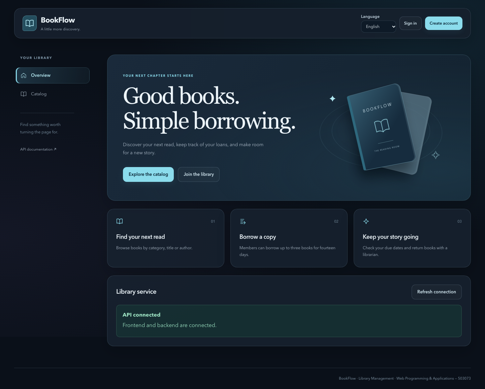
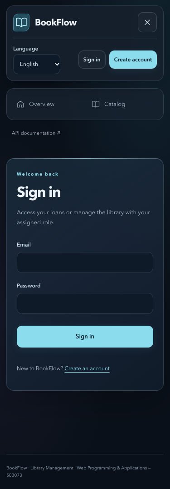

# Library interface

The interface uses a dark library theme across public pages and the authenticated
workspace. The redesign covers the application shell, homepage, login and
registration, catalog cards, book details, and shared forms, tables and feedback.
Administration, loans, categories, users and account pages share the same styles.

## Preview

Desktop homepage at 1440px:



Mobile login at 375px:



## Visual system

- Dark canvas (`#0a1019`), translucent blue panels, cyan accents (`#8bdcec`), and
  solid input surfaces. Success, error and keyboard focus have distinct colors.
- System sans-serif text, with Georgia headings on the homepage. Colors, spacing,
  radii and shadows are defined in `client/src/styles/base.css`.
- Desktop navigation stays beside the content. Tablet navigation narrows, while
  mobile has a labeled collapsible menu, horizontal book cards and tables that
  scroll within their containers.
- Shared controls have a minimum height of 44px. Focus remains visible; decorative
  SVG icons and book artwork are hidden from assistive technology. Book initials
  are decoration; the actual API title and author remain visible beside them.
- Hover feedback lasts 180ms; page entrances move 8px over 420ms. The existing busy
  state controls button spinners. `prefers-reduced-motion` disables animations.

The visual references supplied for the redesign were [a glass dashboard](https://vt.tiktok.com/ZSpBptGWH/),
[an authentication panel](https://vt.tiktok.com/ZSpBsYwde/) and
[a compact navigation bar](https://vt.tiktok.com/ZSpBpc71n/). Their panel depth,
cyan accents and navigation treatment informed the theme. BookFlow retains its
own controls, data and workflows.

## Implementation boundaries

The presentation changes retain existing route guards, session handling, catalog
URL/history and draft state, validation, HTTP requests and business actions. The
backend, database schema, API contract and dependency lockfiles are unchanged.
The new artwork and icons use SVG/CSS; no image service or animation package is
required.

The main presentation files are:

| Area                 | Files                                                                                     |
| -------------------- | ----------------------------------------------------------------------------------------- |
| Shell and navigation | `client/src/app/AppLayout.tsx`, `client/src/styles/layout.css`                            |
| Shared controls      | `client/src/styles/components.css`, `client/src/components/Button.tsx`                    |
| Artwork and icons    | `client/src/components/LibraryArt.tsx`, `BookJacket.tsx`, `Icon.tsx`                      |
| Homepage             | `client/src/features/home/`                                                               |
| Authentication       | `client/src/features/auth/AuthFrame.tsx`, `LoginPage.tsx`, `RegisterPage.tsx`, `auth.css` |
| Catalog and details  | `client/src/features/catalog/CatalogPage.tsx`, `BookDetailPage.tsx`, `catalog.css`        |

## Preview and regression checks

Follow the root [README](../README.md) for installation and configuration, then run
`npm run dev`. Use the configured frontend URL. Environment files and generated
reports remain local.

For automated browser checks, configure an isolated test database whose name ends
in `_test`; see [development profiles](DEV_PROFILES.md). The managed browser API
must use that test database. Never point these write-capable tests at a development
or production database.

```sh
npm run check
npm run test:e2e -- --retries=0
npx playwright test --config=playwright.ui.config.ts --project=chromium --retries=0
```

The responsive matrix runs separately from the core browser suite so it has a
fresh API/request budget. At each of 375, 768, 1024 and 1440px it checks four public
and seven administrator screens for outer horizontal overflow and page JavaScript
errors. It also checks reduced-motion styles and mobile menu keyboard operation.
Screenshots are generated in `.cache/ui-regression/`; the HTML report is in
`playwright-report/ui/`. Both locations are ignored by Git. CI runs this matrix
after the existing desktop and mobile business flows and uploads failure reports.

Local validation on 8 November 2026 used macOS arm64, Node 24.19.0, npm 11 and
PostgreSQL 17.6. The UI branch passed `npm run check` (299 tests), the existing
44 desktop/mobile E2E cases, and all four responsive cases, with no browser retry.
Backend source, database migrations, API specifications and lockfiles have no diff
against the branch's `main` baseline. The PR checks validate the published commit.
Mobile checks use
Chromium emulation; physical devices, Safari and Firefox have not been verified.
