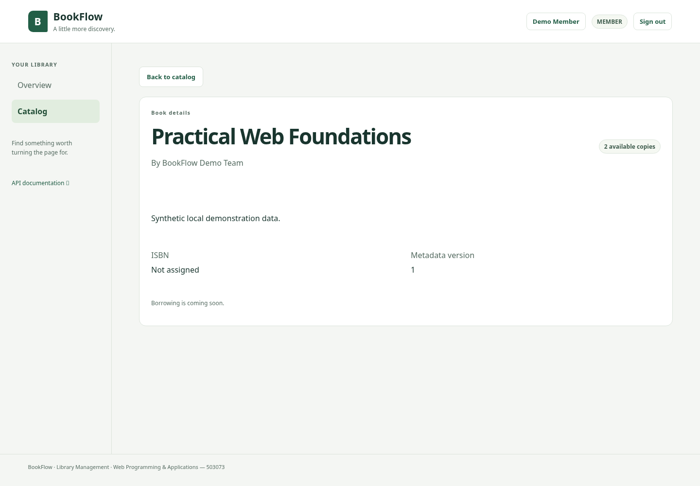
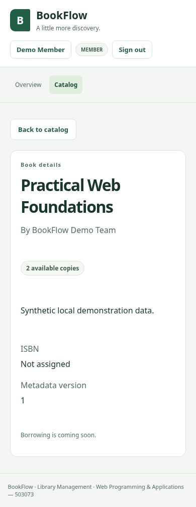

# Catalog review fix — PR #5

The current Catalog build provides browsing, availability and staff catalog/copy
management. Borrow/return requires the separate Loans integration.

## Regression coverage

- Guest and MEMBER book details expose availability without borrowing controls.
- The app navigation and account screen do not offer My loans/All loans.
- Real authenticated desktop/mobile browser tests verify no Loans API request is
  made while viewing the catalog, book details and the account page.
- Metadata 304/live availability and removal of cached details on 404 are tested
  through staff copy updates, without a mocked successful Loans workflow.

## Verification results

Executed in the Codex cloud workspace on 2026-10-23, with Node 24.19.0 and npm
11.9.0. These results describe local runs, not GitHub Actions or a contributor's
personal machine.

- `npm run check`: passed; 66 server unit/HTTP and 59 client unit/component tests,
  lint (React advisories remain), typecheck, production builds, 32 OpenAPI
  operations, Postman JSON validation and Prettier.
- `npm run test:e2e`: all 20 Chromium desktop/mobile cases passed in 19.2 seconds,
  including the authenticated MEMBER regression.
- The first E2E attempt had two failures from the new test using the button's
  visible text instead of its accessible name. The test selector was corrected
  and the full 20-case suite rerun successfully.
- No DB/business logic changed. The 87 PostgreSQL integration tests last passed
  at `a336740`; this UI/documentation correction did not rerun that suite.

The original five handoff commits are retained; the review fix is a separate
follow-up commit. GitHub Actions for that commit and human approval must be
checked before merge. Full Loans integration, manual Postman execution,
all-container deployment and broad accessibility review were not run here.

## Real UI screenshots

Authenticated synthetic MEMBER viewing book details and live availability, with
no borrowing controls or Loans menu. Screenshots were captured from the running
application at 1440px and 390px viewport widths; neither had horizontal overflow.

