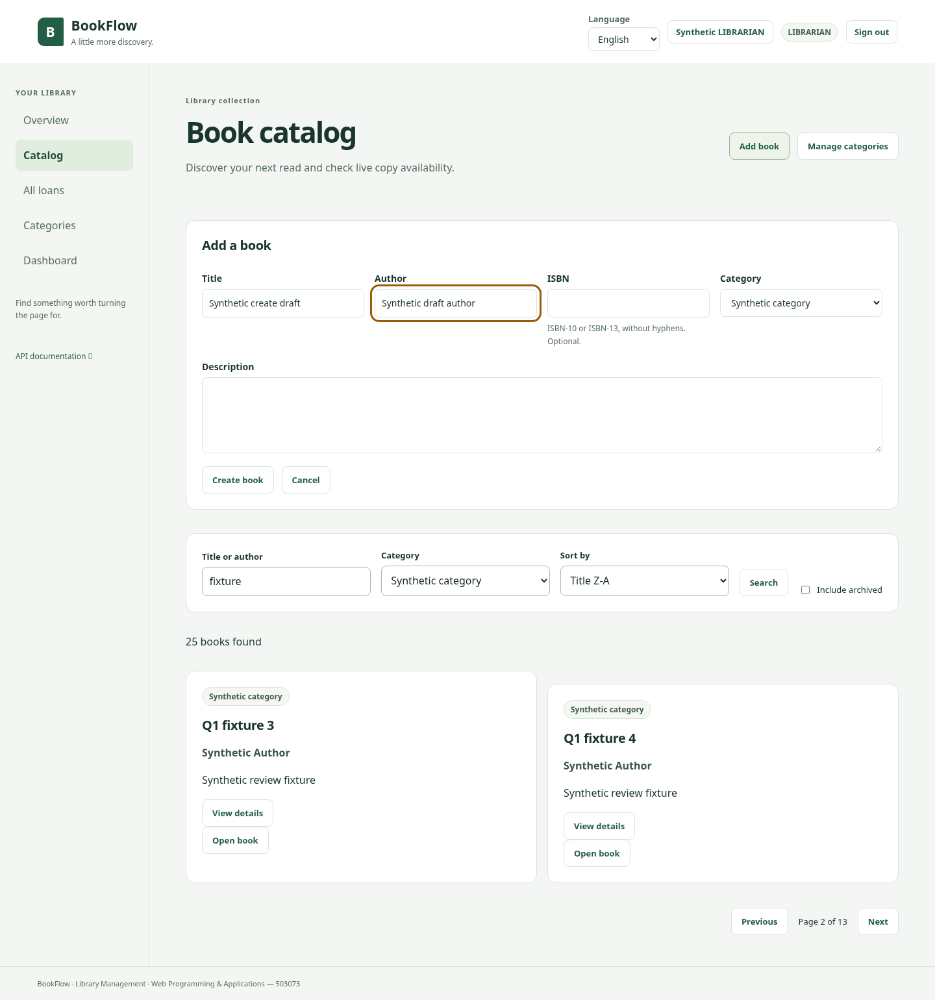
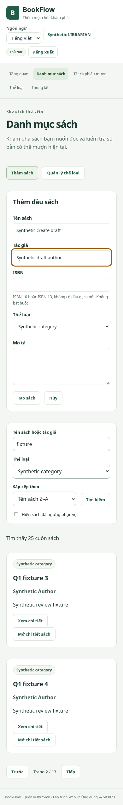
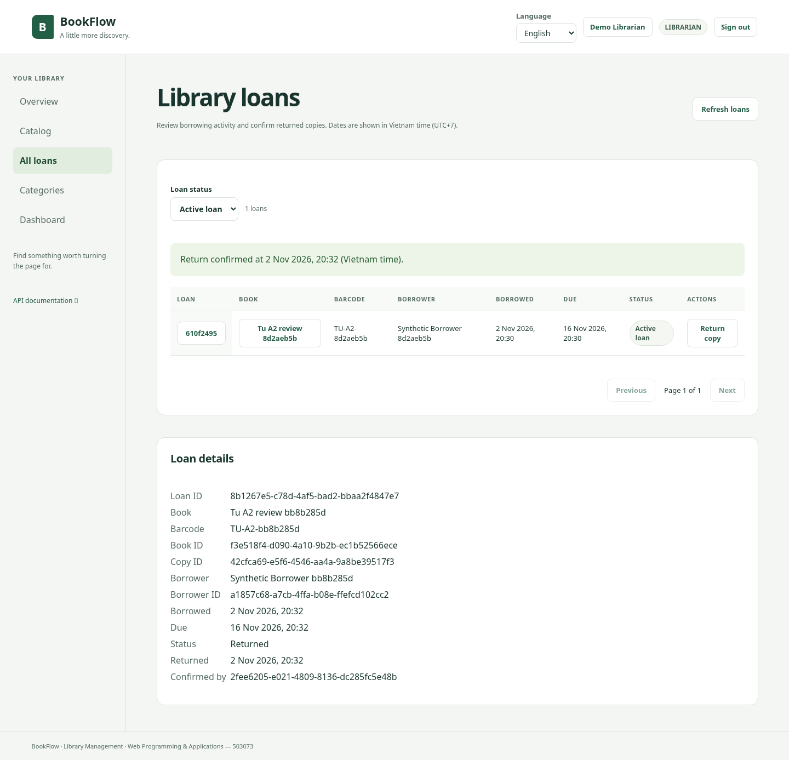
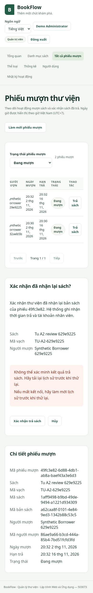

# Bằng chứng review Q1/A2 — 02/11/2026

Đọc [báo cáo và giới hạn](../../TU_FRONTEND_REVIEW.md) trước khi dùng các số liệu.

| Artifact                                   | Nội dung                                                     |
| ------------------------------------------ | ------------------------------------------------------------ |
| [q1-browser.json](q1-browser.json)         | 8 tổ hợp frontend/CSS #9, HTTP mock                          |
| [a2-browser.json](a2-browser.json)         | 8 tổ hợp A2 #10, API/DB test thật; hai lỗi được inject riêng |
| [q1-browser.mjs](reproduce/q1-browser.mjs) | Harness frontend, keyboard và viewport Q1                    |
| [a2-browser.mjs](reproduce/a2-browser.mjs) | Harness MEMBER → staff, cancel/pending/lỗi/trả thật/trả lặp  |

Mẫu comment để người review đọc và gửi: [frontend/Q1 của #9](review-pr9-comment.md) và
[A2 của #10](review-pr10-comment.md).

[Tổng hợp lệnh và kết quả](run-summary.json) ghi SHA, phạm vi và các số liệu
được trích từ log chạy thật; không chứa cấu hình private hoặc credentials.

`createAndEditBarcode: false` trong các dòng MEMBER của JSON Q1 nghĩa là không
áp dụng thao tác staff, không phải test thất bại. Tất cả ca được ghi trong hai
JSON đã hoàn thành; các assertion thất bại làm harness dừng trước khi xuất báo cáo.

## Ảnh chụp

Ảnh Chromium/Linux, dữ liệu tổng hợp; không phải ảnh Windows hoặc máy Mac.









## Chạy lại component regression

Trên source #9 hoặc nhánh Tú, cài dependencies theo lockfiles, dùng Node
24.19.0/npm 11 và thêm file `client/tests/catalog-viewer-review.test.tsx` từ diff
review nếu source chưa có file này. Sau đó chạy:

```text
npm --prefix client test -- --run tests/catalog-viewer-review.test.tsx
npm --prefix client run typecheck
```

Đối chứng key cũ chỉ được làm trên bản sao review: đổi viewer key của Catalog
về role đã dịch, chạy nhóm `keeps MEMBER|keeps every staff|clears edit` để thấy
bốn ca thất bại, rồi phục hồi source trước khi kiểm tra bản đúng. Không sửa source
đang dùng hoặc tạo commit chứa key cũ.

## Chạy lại browser harness bằng PowerShell

Chuẩn bị checkout/bản sao riêng đúng source muốn review và cài dependencies.
Chạy client trên cổng còn trống. Q1 không cần API thật: harness intercept HTTP
của `/api/v1` với fixture tổng hợp. Nó vẫn dùng giao diện/CSS thật của client.
Đặt các biến dưới đây trong terminal chạy harness, không đặt secret trong VITE.

```powershell
$env:REVIEW_SOURCE_SHA = "40eb9143866306725767f3121599e678e3fddc7c"
$env:REVIEW_BASE_URL = "http://127.0.0.1:5181"
$env:REVIEW_OUTPUT_DIR = Join-Path $env:TEMP ("bookflow-q1-review-" + [Guid]::NewGuid().ToString("N"))
node docs/evidence/tu-review-20261102/reproduce/q1-browser.mjs "DUONG_DAN_CHECKOUT_Q1"
```

Thay đối số cuối bằng đường dẫn thật của checkout source #9. Chạy script từ
nhánh có gói evidence này; dependencies được tìm từ repository chứa script.
Script dùng system Chromium trên Linux nếu có, browser Playwright đã cài trên
Windows nếu không có, hoặc PLAYWRIGHT_CHROMIUM_EXECUTABLE_PATH do người chạy đặt.

A2 **tạo dữ liệu thử và thực hiện mượn/trả**. Người chạy phải khởi động API/client
đúng head #10, cấu hình API dùng DB `_test` riêng, migrate/seed DB đó, bảo đảm
web proxy trỏ đúng API và seed password khớp stack. Tên DB/SHA được người chạy
cung cấp; harness không thể tự xác minh DB hoặc SHA qua endpoint công khai.
Không trỏ vào DB phát triển hay dịch vụ chưa xác định. Trong lần review này,
launcher đã cấu hình trực tiếp DB review riêng và kiểm tra readiness trước test.

```powershell
$env:REVIEW_SOURCE_SHA = "3d0695d4693621f012d053c4824eebebb6c82f4f"
$env:REVIEW_BASE_URL = "http://127.0.0.1:5179"
$env:REVIEW_DATABASE_NAME = "bookflow_tu_review_20261102_test"
$env:REVIEW_OUTPUT_DIR = Join-Path $env:TEMP ("bookflow-a2-review-" + [Guid]::NewGuid().ToString("N"))
node docs/evidence/tu-review-20261102/reproduce/a2-browser.mjs
```

Harness đọc SEED_DEMO_PASSWORD từ môi trường hoặc `.env` của repository chứa
script, không in giá trị. Cấu hình này phải khớp API đã khởi động; không nhập
password vào lệnh hoặc đưa `.env` lên GitHub. Sau review, gỡ các biến REVIEW_*
do mình đặt. Không dùng lại thư mục output của báo cáo đã hoàn thành; giữ lịch sử.

Hai harness không tự mở/tắt server và không tăng/tắt rate limit. Nếu lỗi,
giữ kết quả thất bại và kiểm tra nguyên nhân; không đổi assertion để bỏ qua lỗi.
Các log đầy đủ và cấu hình private của lần chạy cloud được giữ ngoài repository.
