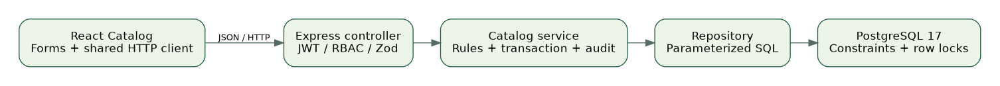
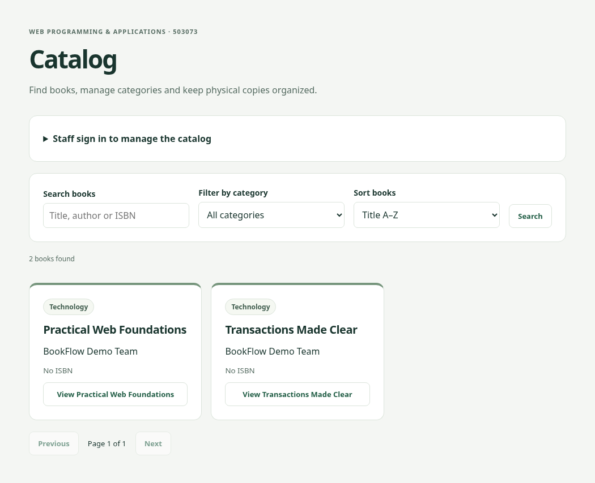
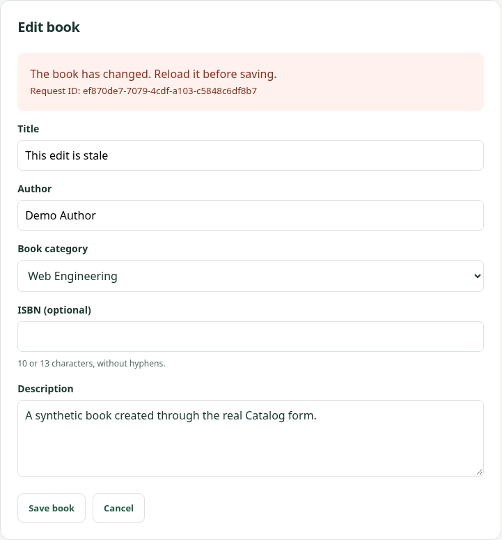

# BookFlow: Catalog and REST API Contract

Contribution chapter — Phạm Văn Tú, 52400252

Topic: RESTful Web Services. Course: Web Programming & Applications (503073), Semester 1, Academic Year 2026–2027. Prepared on 22 October 2026.

This document covers Tú’s assigned contribution: a comparison of REST, GraphQL and SOAP; the Categories, Books and Copies module; API contracts; and the responsive Catalog interface. It is intended to be integrated into the group report, rather than submitted as the complete group report.

Nguyễn Minh Quân (52400227) owns Auth and Users. Phạm Văn Tú (52400252) owns Catalog and shared UI. Lê Nguyễn Vạn An (52400258) owns Loans, Dashboard/Audit and deployment/testing coordination. The existing Auth implementation is an integration prerequisite and is not reattributed to the Catalog contribution.

The implemented system is a React/TypeScript client, an Express/TypeScript JSON API and a PostgreSQL 17 database. Catalog functionality is connected to real database queries. Planned loan and account-management features are distinguished from implemented behavior throughout this chapter.

The Faculty template archive and instructor details have not been supplied. This contribution uses a consistent technical-report layout without inventing a university logo, faculty name or instructor. The final group report still needs the required cover pages, institutional formatting, 20–60 content pages and a recorded English presentation involving all members.

| Deliverable                         | Status                                     |
| ----------------------------------- | ------------------------------------------ |
| Catalog implementation              | Implemented and validated locally          |
| Report, slides, narration script    | Prepared for group integration             |
| Formal Faculty layout / instructor  | Requires group confirmation                |
| Final three-member video with sound | Members must record their own presentation |

# 1. Comparing three approaches on the same problem

REST is an architectural style for distributed hypermedia systems, rather than a synonym for JSON endpoints [1]. A resource-oriented HTTP API can apply methods, representations and conditional requests to a library catalog. GraphQL specifies a typed query language and execution model: a client selects fields and traverses relationships through a schema [3]. SOAP defines an XML-based messaging framework with an envelope and processing rules; its binding framework is not limited to HTTP [4]. These are different kinds of specification, so the comparison should focus on a concrete application need.

For BookFlow, consider listing book metadata, opening one book and updating its title. REST expresses these as requests to book resources. GraphQL could expose a books query and an updateBook mutation. SOAP could describe application-specific operations such as GetBooks and UpdateBook using its message framework and a service contract. The project implements only the REST variant. The other two alternatives below are analytical designs, not deployed endpoints or measured implementations.

The principal selection criteria are contract clarity for a small team, integration with a browser client, authorization, caching semantics and tooling. Performance cannot be ranked without an equivalent implementation, workload and measurement method. No latency or throughput advantage is claimed in this report.

| Criterion         | REST over HTTP in BookFlow         | GraphQL alternative                | SOAP alternative                   |
| ----------------- | ---------------------------------- | ---------------------------------- | ---------------------------------- |
| Abstraction       | Resources and HTTP methods         | Typed fields, queries, mutations   | XML messages and operations        |
| Returned fields   | Defined by endpoint DTO            | Selected by client schema query    | Defined by message contract        |
| Validation        | Zod plus OpenAPI                   | Schema and resolver validation     | Message/schema validation          |
| Authorization     | Route, principal and service rules | Resolver and business-layer rules  | Service and message security rules |
| Caching           | HTTP validators where appropriate  | Operation/transport-aware design   | Transport/application dependent    |
| Primary cost here | More resource endpoints            | Resolver and query-complexity work | XML/tooling and contract overhead  |

# 2. Equivalent use case and selection rationale

The REST request below reads a bounded collection with a category filter and an allowlisted sort. Its response contains safe Book representations and pagination metadata. The client receives the endpoint-defined fields, including description, even if a particular card view only needs a title and author. This is a practical representation trade-off, not proof that REST always over-fetches.

A GraphQL alternative could let the card request select only title, author and category name in one typed operation. That flexibility would require a schema, resolver authorization and bounded query execution. It does not remove the need for database indexes, transactions or consistent business rules. A careless resolver implementation can still perform excessive database queries.

A SOAP alternative could define a GetBooks request and a corresponding XML response. SOAP can be appropriate where existing enterprise contracts, message processing and related standards are required. Those requirements are absent from this small library demonstration. BookFlow therefore selects resource-oriented HTTP with familiar status codes, OpenAPI and a shared browser HTTP client.

The HTTP representation is JSON for this project; REST itself does not require JSON. GraphQL is not inherently faster or more secure. SOAP is not restricted to HTTP. These qualifications avoid treating implementation conventions as universal properties of each approach.

```text
Implemented REST example:
GET /api/v1/books?categoryId=<uuid>&page=1&limit=12&sort=title

Illustrative GraphQL alternative (not implemented):
query { books(categoryId: "<uuid>", page: 1, limit: 12) {
  items { id title author category { name } } total
} }

Illustrative SOAP operation (not implemented):
<soap:Envelope xmlns:soap="http://www.w3.org/2003/05/soap-envelope">
  <soap:Body><GetBooks><CategoryId>...</CategoryId></GetBooks></soap:Body>
</soap:Envelope>
```

# 3. Architecture and request flow

The application follows controller → service → repository boundaries. The controller translates HTTP, validates input with strict Zod schemas and applies authentication/RBAC middleware. The service owns business rules and transaction boundaries. Repositories execute parameterized SQL on the client passed by the service. React receives camelCase DTOs through the existing shared HTTP client.

For example, a staff member submits a new book. The client sends JSON containing categoryId, isbn, title, author and description. The controller rejects unknown fields, verifies the access token and obtains the current role/status from PostgreSQL. The Catalog service verifies staff access and opens a transaction. The repository inserts metadata, and an audit entry is written on the same client. Only after commit does the controller return 201, Location and an ETag.

An invalid input returns a 400 Problem Details response. A member attempting a staff mutation receives 403. Unique-key conflicts are mapped to specific 409 codes rather than exposing PostgreSQL messages. If audit insertion fails, the transaction rolls back the mutation. The HTTP client does not automatically retry a mutation after a timeout, because the original operation may already have committed.



# 4. Resource model and validation

A book is bibliographic metadata, while a copy is an individual physical item. This distinction allows one title to have several barcodes and conditions without duplicating title/author metadata. Categories classify books. Loans reference copies and must retain historical relationships. Consequently, deleting a book in the Catalog API means archiving metadata; changing a copy to RETIRED preserves its record.

Validation is applied before SQL execution. Names and titles are trimmed and length-bounded. Category names are unique case-insensitively; slugs follow lowercase kebab-case. A supplied ISBN must follow the agreed 10/13-character format, with X permitted at the end of ISBN-10. The current contract checks format, not the mathematical ISBN checksum. A null ISBN is permitted. Barcodes are trimmed, bounded and unique.

Search is a case-insensitive substring on title, author or ISBN. User values are SQL parameters; percent and underscore are escaped as literal search characters. Sort keys map to a fixed server allowlist and always add id as a deterministic tie-breaker. Collection count and rows use a repeatable-read snapshot, so pagination metadata agrees with the returned page within a request. Offset pagination may still shift between independent requests when other users change data.

| Resource | Key fields                                   | Consistency rule                                            |
| -------- | -------------------------------------------- | ----------------------------------------------------------- |
| Category | id, name, slug                               | Cannot delete while any book references it                  |
| Book     | categoryId, isbn, title, author, description | version and archivedAt controlled by server                 |
| BookCopy | bookId, barcode, conditionStatus             | New copies AVAILABLE; no condition change with an open loan |
| Audit    | actor, action, entity, requestId             | Commits or rolls back with the mutation                     |

# 5. HTTP contract, permissions and errors

The operational base path is /api/v1. GET reads representations; POST creates a category, book or copy; PUT replaces all writable book/category fields; PATCH updates an allowed subset; DELETE archives a book or removes an unreferenced category. A new resource returns 201 and Location. Successful deletion/archive returns 204 without a body. These behaviors illustrate the HTTP semantics discussed in RFC 9110 [2].

Public users can list categories and active books, read active book metadata and request availability. LIBRARIAN and ADMIN can mutate the catalog and list physical copies. MEMBER does not inherit staff permissions. Archived book metadata is hidden with 404 for public users; explicit includeArchived=true requires staff. Authentication and visibility are checked before a conditional GET can return 304.

Errors use application/problem+json and a requestId that can be correlated with logs [5]. The client displays a useful message and field errors where available. SQL details, password hashes and access tokens are not included in these error representations.

| Route group              | Methods            | Result / significant failures               |
| ------------------------ | ------------------ | ------------------------------------------- |
| /categories              | GET, POST          | 200 list; 201 create; 409 duplicate         |
| /categories/{id}         | PUT, DELETE        | 200 / 204; 409 CATEGORY_IN_USE              |
| /books                   | GET, POST          | 200 list; 201 with Location/ETag            |
| /books/{id}              | GET                | 200 or 304; hidden/missing 404              |
| /books/{id}              | PUT, PATCH, DELETE | 200 / 204; 428 missing validator; 412 stale |
| /books/{id}/availability | GET                | 200 fresh count; no-store                   |
| /books/{id}/copies       | GET, POST          | 200 / 201; staff only                       |
| /copies/{id}             | PATCH              | 200; 409 COPY_HAS_ACTIVE_LOAN               |

# 6. Concurrent edits, archiving and physical copies

A book ETag is a strong metadata version such as "book-<uuid>-v2". Editing requires an exact If-Match value. The service locks the book row with FOR UPDATE, compares the version inside the transaction and then applies the update. Two writes using the same validator cannot silently overwrite one another: one succeeds and increments the version, while the other receives 412. A missing validator receives 428. This is optimistic concurrency at the HTTP boundary combined with database serialization for the critical section.

Archiving takes the book lock before checking whether any physical copy has an open loan. Changing a copy condition locks the copy before checking its open loan. These rules depend on the future Loans module following the shared book → copy locking convention when borrowing. The Catalog tests simulate a borrower with an independent database connection, observe the Catalog request waiting for the lock, commit a loan and verify a 409 response. They do not imply that the loan HTTP API has been implemented.

Availability is calculated from AVAILABLE copies without open loans. It is not part of the metadata version and always uses a fresh no-store operational response. A copy condition change can therefore alter availability without pretending the bibliographic metadata has changed.

| Sequence          | Session A                  | Session B                           |
| ----------------- | -------------------------- | ----------------------------------- |
| Read              | GET returns ETag v1        | GET returns ETag v1                 |
| First write       | If-Match v1 succeeds → v2  | Still editing an old representation |
| Conflicting write | Committed metadata remains | If-Match v1 → 412; reload required  |

# 7. Public Catalog interface

The Catalog reuses shared Button, FormField, Feedback, Pagination and HTTP utilities instead of introducing separate request/error formats. A visitor can search, filter by category, choose an allowed sort, change pages and inspect metadata with the current availability. The UI shows actual API responses rather than placeholder book data.

Loading, empty and error states are explicit. AbortController cancels requests when a screen or filter changes. A loader identity prevents late responses from replacing newer results. Search/filter changes reset the page where appropriate. Server-side permissions remain authoritative even when management controls are not rendered for a visitor.



# 8. Staff workflow and conflict recovery

Staff sign-in uses the existing Auth API. The access token is kept in memory, not localStorage. A refresh of the page requires another sign-in because the refresh/logout endpoints are still planned. The Sign out action currently removes the local access token; it does not revoke a server-side refresh family.

The staff interface can create/edit categories, add/edit/archive books, create copies and change physical conditions. Deletion/archive require confirmation. Buttons block repeated submissions while work is pending, and database uniqueness/transaction rules enforce correctness independently of the UI. A failed mutation preserves the form so the user can correct it.

The conflict example is produced by a real second API request after the edit form has loaded its validator. Submitting that stale form receives 412. The UI asks the user to reload the current book before trying again; it does not silently resubmit against a new version.



# 9. Validation and evidence

The development environment uses Node 24.19.0, npm 11 and PostgreSQL 17. Tests are run against the repository commands, and only executed results are reported. Integration tests require a database name ending _test and create independent random schemas that are cleaned up afterwards. Browser Catalog tests run a separate API scoped to a test schema, so staff mutations do not modify the development database.

The current validation contains 59 foundation unit/HTTP/component tests, 52 integration tests and 10 browser tests: 121 passed. Of the integration tests, 24 are Catalog-specific and 28 cover Auth/database foundations. Four browser cases cover Catalog in desktop/mobile projects; the other six are foundation regressions. These numbers are local results, not an assertion that GitHub CI or production deployment has passed.

Meaningful Catalog cases include guest/member rejection, invalid UUIDs/body/query data, duplicate category/ISBN/barcode conflicts, pagination/search/sort, ETag 304/412/428, concurrent same-version writes, archived visibility, loan-related archive/condition guards and rollback when audit insertion fails. Browser cases exercise creation/editing/archive, copy availability, conflict reload, category deletion errors, empty/error/retry states and responsive overflow checks.

| Executed command           | Outcome                            | Evidence                          |
| -------------------------- | ---------------------------------- | --------------------------------- |
| npm run check              | Passed; includes 59 tests          | logs/check.txt                    |
| npm run test:integration   | 52 passed, 0 failed                | logs/integration.txt              |
| npm run test:e2e           | 10 passed, desktop/mobile          | logs/e2e.txt                      |
| Visual rehearsal recording | Real isolated browser/API workflow | video/ + logs/recording-http.json |

# 10. Limitations, integration and conclusion

The Catalog contribution demonstrates resource modeling, method/status semantics, strict contracts, authorization, conditional requests and transaction-protected rules through a connected UI. It does not establish full compliance with every REST constraint: the API has limited hypermedia, and most responses are deliberately no-store. The project should therefore explain its resource-oriented HTTP design accurately instead of claiming that JSON routes alone prove complete REST maturity.

Known limitations include offset pagination for deep pages, a single category and author string per book, format-only ISBN checks, and a small synthetic data set. No performance benchmark, high-availability deployment or second-machine restoration result is fabricated. Front-end accessibility work covers labels, keyboard-friendly native controls, visible feedback and responsive checks; it is not a formal accessibility certification.

The next team integration work is Auth refresh/logout and full account screens, plus Loans, Dashboard and Audit UI. Loan service locking must remain consistent with the Catalog safeguards. A draft PR should be reviewed against the existing feature branches before merge; one person should not overwrite another member’s history to make a contribution appear complete.

Tú’s presentation can now explain a full Catalog request flow, the REST/GraphQL/SOAP choice and a concurrent-edit failure with evidence. The final submission remains a group responsibility: apply the Faculty template, verify instructor/course metadata, combine chapters into 20–60 content pages and record all three members speaking English within the 20-minute limit.

# References and artifact guide

[1] R. T. Fielding, Architectural Styles and the Design of Network-based Software Architectures, doctoral dissertation, 2000, Chapter 5. https://ics.uci.edu/~fielding/pubs/dissertation/rest_arch_style.htm

[2] IETF, RFC 9110: HTTP Semantics, 2022. In particular, method semantics, conditional requests and response status codes. https://www.rfc-editor.org/rfc/rfc9110.html

[3] GraphQL Foundation, GraphQL Specification, September 2025 edition. Type system, validation and execution. https://spec.graphql.org/September2025/

[4] W3C, SOAP Version 1.2 Part 1: Messaging Framework, Second Edition, 2007. https://www.w3.org/TR/soap12-part1/

[5] IETF, RFC 9457: Problem Details for HTTP APIs, 2023. https://www.rfc-editor.org/rfc/rfc9457.html

[6] node-postgres documentation, Transactions. https://node-postgres.com/features/transactions

[7] Course assignment: 503073-Midterm-V1.docx, sections III–V, stored in docs/. The separate Faculty template archive is not present in the repository.

Companion artifacts: BookFlow_Tu_Slides.pptx is editable and contains speaker notes; BookFlow_Tu_Slides.pdf is a reading copy. SPEAKER_SCRIPT.md provides an approximately six-minute English segment. The silent practice MP4 and subtitles are rehearsal aids and must not be submitted as the required group video with sound.

Full implementation/route details: docs/CATALOG_HANDOFF.md and docs/openapi.yaml. Existing real seed-data screenshots are in docs/evidence/. This chapter’s figures come from a fresh isolated test fixture. The references above identify authoritative standards; direct GraphQL/W3C retrieval was blocked by this environment’s network policy, so no claim of a live standards-site verification is made.
